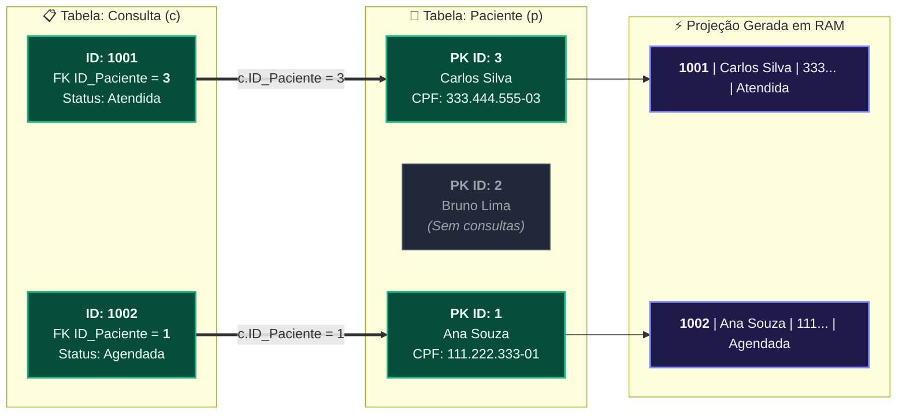
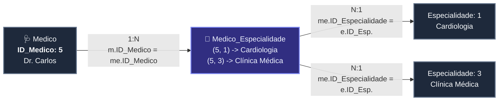
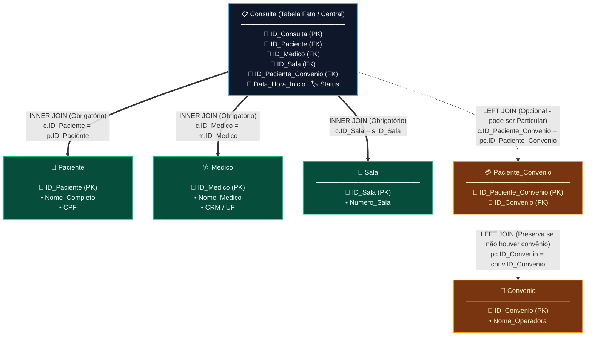
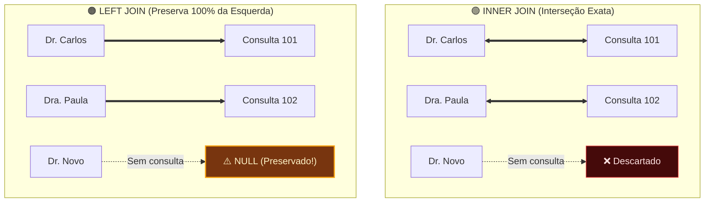

# Aula 06: DQL Relacional – Reconstruindo a Planilha com JOINs

**Contexto:** Conectar as tabelas que foram separadas na normalização do [dados_hospital.csv](dados_hospital.csv) para gerar relatórios completos.  
**Tabelas Principais:** `Consulta`, `Paciente`, `Medico`, `Especialidade`, `Medico_Especialidade`, `Sala`, `Convenio`.

---

## 🎯 Objetivos da Aula
1. Entender o papel do `JOIN`: recompor as informações espalhadas pela normalização sem gerar redundância no disco.
2. Dominar a sintaxe do `INNER JOIN` associando Chaves Primárias (`PK`) a Chaves Estrangeiras (`FK`).
3. Aprender a encadear múltiplos `JOINs` para ligar 3, 4 ou mais tabelas.
4. Trabalhar com tabelas associativas N:M (`Medico_Especialidade`).
5. Compreender o funcionamento do `LEFT JOIN` para preservar registros da tabela principal mesmo sem correspondência na tabela relacionada.

---

## 1. Por que precisamos do JOIN?

Na planilha original [dados_hospital.csv](dados_hospital.csv), tudo estava em uma única linha:
> *"Consulta 1001 | João Silva | Dr. Carlos Almeida | Cardiologia | Sala 101 | Unimed"*

Quando normalizamos, quebramos essa linha em várias tabelas para evitar redundâncias e anomalias. 
O **`JOIN` é o comando que "cola" as tabelas de volta sob demanda**, apenas na memória durante a execução da consulta, gerando a visualização exata que o usuário ou sistema precisa.

---

## 2. `INNER JOIN` (Junção Interna)

Retorna **apenas as linhas que possuem correspondência em ambas as tabelas**.

### 2.1. Ligando 2 Tabelas: Consulta + Paciente
Mostrar a data da consulta e o nome real do paciente (em vez de um código numérico ilegível):

```sql
SELECT 
    c.ID_Consulta,
    c.Data_Hora_Inicio,
    p.Nome_Completo AS Nome_Paciente,
    p.CPF,
    c.Status
FROM Consulta c
INNER JOIN Paciente p ON c.ID_Paciente = p.ID_Paciente;
```

#### Como o SGBD cruza as tuplas em Memória (RAM):



| ID_Consulta | Nome_Paciente | CPF | Status |
| :--- | :--- | :--- | :--- |
| `1001` | `Carlos Silva` | `333.444.555-03` | `Atendida` |
| `1002` | `Ana Souza` | `111.222.333-01` | `Agendada` |

> 💡 **Nota:** O paciente `Bruno Lima` (ID 2) não aparece no resultado final porque o `INNER JOIN` descarta qualquer registro que não possua correspondência mútua.

### 2.2. Ligando 3 Tabelas: Consulta + Paciente + Médico
Adicionando o médico responsável pelo atendimento:

```sql
SELECT 
    c.ID_Consulta,
    c.Data_Hora_Inicio,
    p.Nome_Completo AS Paciente,
    m.Nome_Medico AS Medico,
    m.CRM || '/' || m.UF_CRM AS Registro_CRM,
    c.Status
FROM Consulta c
INNER JOIN Paciente p ON c.ID_Paciente = p.ID_Paciente
INNER JOIN Medico m   ON c.ID_Medico = m.ID_Medico;
```

### 2.3. Resolvendo o Relacionamento N:M: O Guia Médico do Hospital
Para saber o nome das especialidades de cada médico, precisamos passar pela tabela associativa `Medico_Especialidade`:

```sql
SELECT 
    m.Nome_Medico,
    m.CRM,
    e.Nome_Especialidade
FROM Medico m
INNER JOIN Medico_Especialidade me ON m.ID_Medico = me.ID_Medico
INNER JOIN Especialidade e         ON me.ID_Especialidade = e.ID_Especialidade
ORDER BY m.Nome_Medico;
```

#### Representação Gráfica do Relacionamento N:M:


### 2.4. O "Grand Finale": Reconstruindo a Linha Completa do CSV
Esta consulta remonta exatamente a visão integrada que o hospital tinha no arquivo CSV:

```sql
SELECT 
    c.ID_Consulta,
    c.Data_Hora_Inicio,
    p.Nome_Completo AS Paciente,
    p.CPF AS CPF_Paciente,
    m.Nome_Medico AS Medico,
    s.Numero_Sala AS Sala,
    conv.Nome_Operadora AS Convenio,
    c.Status
FROM Consulta c
INNER JOIN Paciente p          ON c.ID_Paciente = p.ID_Paciente
INNER JOIN Medico m            ON c.ID_Medico = m.ID_Medico
INNER JOIN Sala s              ON c.ID_Sala = s.ID_Sala
LEFT JOIN Paciente_Convenio pc ON c.ID_Paciente_Convenio = pc.ID_Paciente_Convenio
LEFT JOIN Convenio conv        ON pc.ID_Convenio = conv.ID_Convenio
ORDER BY c.Data_Hora_Inicio;
```

#### Representação Gráfica do "Grand Finale" (Topologia do JOIN):


> **Legenda visual:**
> - 🟩 **Linhas duplas contínuas (`INNER JOIN`)**: Relações estritas. A consulta só é exibida se paciente, médico e sala existirem simultaneamente.
> - 🟧 **Linhas tracejadas (`LEFT JOIN`)**: Relações opcionais. Se a consulta for particular (`ID_Paciente_Convenio` for `NULL`), a linha da consulta é mantida e os campos de convênio são preenchidos com `NULL`.

---

## 3. `LEFT JOIN` (Junção Externa à Esquerda)

O `LEFT JOIN` retorna **todas as linhas da tabela da esquerda (tabela base)**, mesmo que não haja nenhuma correspondência na tabela da direita (preenchendo os campos faltantes com `NULL`).

### 3.1. Quando usar o LEFT JOIN?
* Identificar registros órfãos ou sem movimentação.
* Exibir relatórios inclusivos onde ninguém pode ficar de fora.

### 3.2. Exemplo 1: Todos os médicos e suas consultas (inclusive os sem agenda)
```sql
SELECT 
    m.Nome_Medico,
    m.CRM,
    c.ID_Consulta,
    c.Data_Hora_Inicio,
    c.Status
FROM Medico m
LEFT JOIN Consulta c ON m.ID_Medico = c.ID_Medico;
```
> Se houver algum médico recém-contratado sem consultas, ele aparecerá na listagem com os campos da consulta preenchidos como `NULL`. No `INNER JOIN`, ele seria sumariamente excluído do relatório!

### 3.3. Exemplo 2: Detectando Pacientes que Nunca Consultaram ("Anti-Join")
```sql
SELECT 
    p.ID_Paciente,
    p.Nome_Completo,
    p.CPF
FROM Paciente p
LEFT JOIN Consulta c ON p.ID_Paciente = c.ID_Paciente
WHERE c.ID_Consulta IS NULL;
```

---

## 📋 Resumo Visual: INNER JOIN vs LEFT JOIN



| Tipo de JOIN | Descrição Didática | Linhas Retornadas |
| :--- | :--- | :--- |
| **`INNER JOIN`** | Interseção exata entre os dois lados | Apenas linhas com correspondência em ambas as tabelas |
| **`LEFT JOIN`** | Preserva 100% da tabela da esquerda | Todas da esquerda + correspondências da direita (ou `NULL`) |

---

## 🏋️ Exercícios Práticos da Aula 06

1. **(INNER JOIN Simples):** Faça uma consulta que liste o nome de cada paciente e todas as suas alergias registradas (`Paciente` + `Paciente_Alergia`).
2. **(INNER JOIN Triplo):** Liste o número da consulta, o nome do paciente, o nome do medicamento prescrito e a dosagem recomendada (`Consulta` + `Prescricao` + `Medicamento`).
3. **(INNER JOIN com Filtro):** Gere um relatório com o nome do médico, número da sala e data da consulta apenas para atendimentos agendados na sala `101`.
4. **(LEFT JOIN Diagnóstico):** Liste o nome de todas as salas cadastradas e seus equipamentos (`Sala` + `Equipamento`). Salas vazias (sem equipamentos) devem aparecer com valor `NULL` nos campos do equipamento.
5. **(Desafio):** Localize quais médicos não possuem nenhuma especialidade cadastrada na tabela `Medico_Especialidade`.
