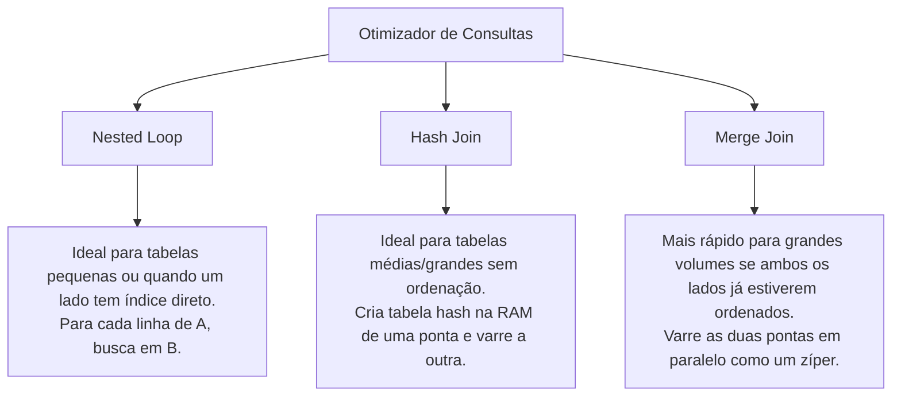
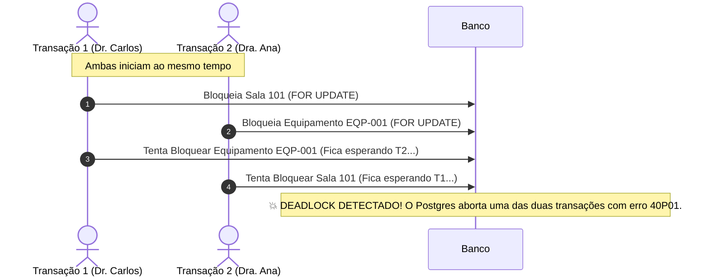

# Aula 01: Engenharia Relacional, Concorrência e Alta Performance (4 Horas)

**Disciplina:** Tópicos Avançados de Banco de Dados  
**Duração:** 4 Horas  
**Foco:** PostgreSQL 15+, Diagnóstico de Consultas, Concorrência Transacional e Otimização em Larga Escala.

---

## 🎯 Roteiro da Aula

1. **Parte 1 (60 min):** Diagnóstico Profundo com `EXPLAIN` e `EXPLAIN ANALYZE`.
2. **Parte 2 (60 min):** Tuning Prático, Nós de Execução e Algoritmos de Junção.
3. **Parte 3 (60 min):** MVCC, Níveis de Isolamento, Bloqueios (*Locks*) e Deadlocks.
4. **Parte 4 (60 min):** Particionamento Declarativo de Tabelas e Uso Híbrido com `JSONB`.

---

# PARTE 1: Diagnóstico com EXPLAIN e EXPLAIN ANALYZE

O erro mais comum de desenvolvedores júnior e pleno é criar índices "no chute" sem inspecionar o que o planejador de consultas realmente faz.

### 1.1. `EXPLAIN` vs `EXPLAIN ANALYZE`
* **`EXPLAIN query;`**: Não roda a consulta. Apenas exibe o plano de execução e o custo estimado com base nas estatísticas do catálogo (`pg_statistic`).
* **`EXPLAIN ANALYZE query;`**: **Executa** a consulta fisicamente no motor, medindo o tempo real decorrido em cada nó da árvore de execução.

```sql
-- Exemplo de diagnóstico completo no PostgreSQL
EXPLAIN (ANALYZE, BUFFERS, VERBOSE)
SELECT c.ID_Consulta, p.Nome_Completo, c.Valor_Total_Faturado
FROM Consulta c
JOIN Paciente p ON c.ID_Paciente = p.ID_Paciente
WHERE c.Status = 'Realizada' AND c.Valor_Total_Faturado > 200.00;
```

### 1.2. Decodificando as Métricas do Plano

```text
Bitmap Heap Scan on consulta c  (cost=4.32..15.80 rows=12 width=40) (actual time=0.045..0.089 rows=10 loops=1)
  Recheck Cond: (status = 'Realizada'::text)
  Filter: (valor_total_faturado > 200.00)
  Buffers: shared hit=4
  ->  Bitmap Index Scan on idx_consulta_status  (cost=0.00..4.32 rows=25 width=0) (actual time=0.021..0.021 rows=25 loops=1)
```

* **`cost=4.32..15.80`**:
  * `4.32`: Custo de inicialização (startup cost) para devolver a primeira linha.
  * `15.80`: Custo total estimado para retornar todas as linhas (medido em unidades de I/O de página).
* **`rows=12` vs `actual rows=10`**: Se a estimativa do planejador diferir brutalmente do real (ex: estimou 10 e vieram 1.000.000), as estatísticas do banco estão desatualizadas (necessário rodar `ANALYZE nome_tabela`).
* **`loops=1`**: Quantas vezes esse nó foi executado (comum em `Nested Loops`). O tempo real deve ser multiplicado pelo número de loops.
* **`Buffers: shared hit=4`**: Mostra quantas páginas de 8KB foram lidas da memória RAM (cache do Postgres). Se aparecer `read`, significa que houve leitura lenta direto do disco (SSD/HD).

---

# PARTE 2: Estratégias de Tuning e Algoritmos de Junção

### 2.1. Como o Banco Cruza Dados (Join Algorithms)



### 2.2. O Perigo das Queries Não-Sargable (Search Argument Able)

Uma query é **não-sargable** quando aplica uma função ou transformação sobre a coluna indexada, impedindo o banco de percorrer a árvore B-Tree:

```sql
-- ❌ RUIM (Não usa o índice B-Tree tradicional de CPF):
SELECT * FROM Paciente WHERE SUBSTRING(CPF, 1, 3) = '111';

-- ❌ RUIM (Força Seq Scan se o índice for na coluna pura):
SELECT * FROM Paciente WHERE UPPER(Nome_Completo) = 'JOÃO SILVA';

--  CORRETO: Índice Funcional (Expression Index)
CREATE INDEX idx_paciente_nome_upper ON Paciente (UPPER(Nome_Completo));
-- Agora a consulta abaixo usa INDEX SCAN instantaneamente:
SELECT * FROM Paciente WHERE UPPER(Nome_Completo) = 'JOÃO SILVA';
```

---

# PARTE 3: Concorrência, MVCC, Bloqueios e Deadlocks

### 3.1. MVCC (Multi-Version Concurrency Control)
O PostgreSQL não sobrescreve linhas no disco durante um `UPDATE` ou `DELETE`. 
* Um `DELETE` marca a tupla como invisível gravando o ID da transação no cabeçalho oculto `xmax`.
* Um `UPDATE` grava uma **nova linha** com seu próprio `xmin` e encerra a linha antiga preenchendo o `xmax`.
* **Consequência arquitetural:** Linhas mortas (*dead tuples*) acumulam-se no disco, gerando inchaço (*bloat*). O processo de **`VACUUM`** (e `autovacuum`) limpa esse espaço para reutilização.

### 3.2. Níveis de Isolamento no PostgreSQL

| Nível de Isolamento | Leitura Suja (*Dirty Read*) | Leitura Não-Repetível (*Non-Repeatable Read*) | Leitura Fantasma (*Phantom Read*) | Desvio de Serialização (*Serialization Anomaly*) |
| :--- | :---: | :---: | :---: | :---: |
| **Read Committed** (Padrão) | Não ocorre no Postgres | Pode ocorrer | Pode ocorrer | Pode ocorrer |
| **Repeatable Read** | Não | Não | Não (no Postgres) | Pode ocorrer |
| **Serializable** | Não | Não | Não | **Totalmente prevenido** |

### 3.3. Bloqueios de Linha Pessimistas (`FOR UPDATE`)

Imagine um sistema hospitalar onde dois médicos tentam reservar a mesma Sala Cirúrgica no mesmo horário. Sem bloqueio, temos condição de corrida (*Race Condition*).

```sql
-- Sessão 1 (Médico A tenta agendar):
BEGIN;
SELECT ID_Sala, Numero_Sala 
FROM Sala 
WHERE ID_Sala = 101 
FOR UPDATE; -- Bloqueia a linha da sala exclusivamente!

-- Sessão 2 (Médico B tenta agendar a MESMA sala):
BEGIN;
SELECT ID_Sala, Numero_Sala 
FROM Sala 
WHERE ID_Sala = 101 
FOR UPDATE; 
-- ⚠️ A Sessão 2 fica CONGELADA esperando a Sessão 1 dar COMMIT ou ROLLBACK!

-- Sessão 1 finaliza:
INSERT INTO Consulta (ID_Sala, Data_Hora_Inicio, ...) VALUES (101, ...);
COMMIT; -- Libera o lock para a Sessão 2.
```

### 3.4. Anatomia do Deadlock

Ocorre quando duas ou mais transações dependem mutuamente da liberação de recursos bloqueados pela outra.



---

# PARTE 4: Particionamento Declarativo e Modelagem Semi-estruturada (`JSONB`)

### 4.1. Particionamento Declarativo por Intervalo (`RANGE`)

Quando a tabela `Consulta` chega a 50 milhões de registros, criar uma tabela única compromete a manutenção de índices e a memória. A solução é particionar por ano/mês:

```sql
-- Tabela Mestre (Não armazena dados físicos diretamente)
CREATE TABLE Atendimento_Particionado (
    ID_Atendimento BIGSERIAL,
    Data_Atendimento DATE NOT NULL,
    ID_Paciente INT NOT NULL,
    Valor_Total NUMERIC(10,2),
    PRIMARY KEY (ID_Atendimento, Data_Atendimento) -- A chave de partição DEVE compor a PK!
) PARTITION BY RANGE (Data_Atendimento);

-- Criação das Partições Físicas
CREATE TABLE Atendimento_2023_Q3 PARTITION OF Atendimento_Particionado
    FOR VALUES FROM ('2023-07-01') TO ('2023-10-01');

CREATE TABLE Atendimento_2023_Q4 PARTITION OF Atendimento_Particionado
    FOR VALUES FROM ('2023-10-01') TO ('2024-01-01');

-- Teste de Partition Pruning (O Postgres lê SOMENTE a partição do 4º trimestre de 2023):
EXPLAIN SELECT * FROM Atendimento_Particionado 
WHERE Data_Atendimento = '2023-10-15';
```

### 4.2. JSONB: Quando e Como Usar

O PostgreSQL permite unir o rigor ACID com a agilidade NoSQL usando colunas `JSONB`.

```sql
-- Tabela com auditoria e campos livres de exames:
CREATE TABLE Prontuario_Eletronico (
    ID_Prontuario SERIAL PRIMARY KEY,
    ID_Paciente INT NOT NULL,
    Data_Registro TIMESTAMP DEFAULT NOW(),
    Metadados_Exame JSONB NOT NULL
);

-- Inserção de dados flexíveis
INSERT INTO Prontuario_Eletronico (ID_Paciente, Metadados_Exame) VALUES
(1, '{
    "pressao": "12/8",
    "glicemia": 95,
    "sintomas": ["cefaleia", "fadiga"],
    "retorno_obrigatorio": true
}');

-- Índice Invertido GIN para buscas ultrarrápidas no interior do JSONB
CREATE INDEX idx_prontuario_gin ON Prontuario_Eletronico USING GIN (Metadados_Exame);

-- Consulta acelerada pelo índice GIN com o operador de contenção (@>):
SELECT * FROM Prontuario_Eletronico 
WHERE Metadados_Exame @> '{"retorno_obrigatorio": true}';
```
