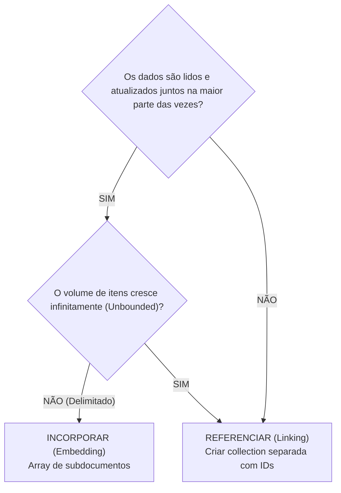
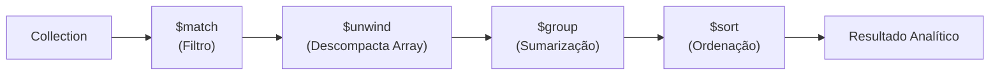

# Aula 02: Paradigma NoSQL, MongoDB e Sistemas Distribuídos (4 Horas)

**Disciplina:** Tópicos Avançados de Banco de Dados  
**Duração:** 4 Horas  
**Foco:** MongoDB 6+, Modelagem Orientada a Documentos, Aggregation Framework, Teorema CAP e Arquiteturas Distribuídas.

---

## 🎯 Roteiro da Aula

1. **Parte 1 (60 min):** Transição de Paradigma: Por que NoSQL? A Grande Decisão: *Embedding* vs *Referencing*.
2. **Parte 2 (60 min):** BSON, Operações em Coleções e Manipulação Avançada de Arrays (`$elemMatch`).
3. **Parte 3 (60 min):** *Aggregation Framework*: Construindo esteiras analíticas sem SQL.
4. **Parte 4 (60 min):** Alta Disponibilidade (Replicação), Escalabilidade Horizontal (Sharding), Teorema CAP e LGPD.

---

# PARTE 1: Transição de Paradigma e a Modelagem em Documentos

No mundo relacional, modelamos normalizando em tabelas atômicas e reconstruímos sob demanda com `JOIN`.  
No MongoDB, **modelamos em função dos padrões de consulta da aplicação** (*Application Access Patterns*).

### 1.1. Comparativo Fundamental

| Aspecto | Modelo Relacional (PostgreSQL) | Modelo Orientado a Documentos (MongoDB) |
| :--- | :--- | :--- |
| **Unidade de Armazenamento** | Tabela com Linhas (Tuplas rígidas) | Coleção com Documentos BSON (Flexíveis) |
| **Integridade de Esquema** | Forçada rigidamente pelo motor (DDL) | Dinâmica ou guiada por validação JSON Schema |
| **Relacionamentos** | Chaves Estrangeiras (`FK`) e `JOIN` no servidor | Incorporação (*Embedding*) ou Referência (*Linking*) |
| **Escalabilidade Típica** | Vertical (Mais CPU / Mais RAM) | Horizontal nativa (*Sharding* em múltiplos nós) |
| **Transações** | ACID completo e estrito por padrão | ACID em documento único nativo; multi-documento sob demanda |

### 1.2. A Decisão Crítica: Incorporar (*Embed*) ou Referenciar (*Reference*)?



#### Regras de Ouro:
1. **Incorpore (Embed)** quando:
   * A relação for `1:1` ou `1:N` contido e limitado (ex: Telefones de um Paciente, Itens de uma Prescrição).
   * O dado incorporado tem significado estritamente vinculado àquele momento no tempo (uma "fotografia" imutável, como o preço pago no procedimento da consulta).
2. **Referencie (Reference)** quando:
   * A relação for `N:M` complexa (ex: Médicos e Especialidades).
   * O documento puder ultrapassar o limite rígido de **16MB por documento** do MongoDB (o perigo do *unbounded growth*).
   * As entidades forem frequentemente atualizadas de forma autônoma (ex: dados cadastrais do Convênio).

---

# PARTE 2: BSON e Manipulação Avançada de Arrays

Um documento MongoDB é serializado internamente em **BSON** (Binary JSON), suportando tipos como `Date`, `ObjectId`, `NumberDecimal` e inteiros de 64 bits.

### 2.1. Anatomia de um Documento Hospitalar

```javascript
// Exemplo de atendimento médico completo em MongoDB
{
  "_id": ObjectId("6520e1a123f8b1a23c4d5e6f"),
  "atendimento_id": 1001,
  "data_hora": ISODate("2023-10-15T08:00:00Z"),
  "status": "Realizada",
  "paciente": {
    "cpf": "111.111.111-11",
    "nome": "João Silva",
    "telefones": ["(11) 9999-1111", "(11) 3333-2222"],
    "alergias": ["Amendoim", "Penicilina"]
  },
  "medico": {
    "crm": "12345/SP",
    "nome": "Dr. Carlos Almeida",
    "especialidade_atuacao": "Cardiologia"
  },
  "sala": {
    "numero": 101,
    "andar": "1º Andar"
  },
  "faturamento": {
    "convenio": "Unimed",
    "carteirinha": "UNI-98765",
    "valor_total": NumberDecimal("150.00")
  },
  "procedimentos": [
    { "codigo": "1010", "nome": "Eletrocardiograma", "valor": NumberDecimal("150.00") },
    { "codigo": "2020", "nome": "Aferição de Pressão", "valor": NumberDecimal("0.00") }
  ],
  "prescricoes": [
    { "medicamento": "Aspirina 100mg", "posologia": "2x ao dia" },
    { "medicamento": "Losartana 50mg", "posologia": "1x ao dia" }
  ]
}
```

### 2.2. A Importância do `$elemMatch`

Se você buscar por múltiplos critérios dentro de um array de objetos, uma busca normal pode cruzar elementos diferentes. O **`$elemMatch`** garante que **todos** os critérios sejam atendidos pelo **mesmo elemento**:

```javascript
// Localizar atendimentos onde o MESMO procedimento custou mais de 100 reais E era o Eletrocardiograma:
db.atendimentos.find({
  procedimentos: {
    $elemMatch: {
      codigo: "1010",
      valor: { $gte: 100.00 }
    }
  }
});
```

---

# PARTE 3: O Pipeline de Agregação (*Aggregation Framework*)

O *Aggregation Framework* é o canivete suíço analítico do MongoDB. Ele processa documentos através de uma esteira (*pipeline*) sequencial de estágios.



### 3.1. Caso Prático: Faturamento Total por Especialidade Médica

```javascript
db.atendimentos.aggregate([
  // Estágio 1: Filtrar apenas atendimentos finalizados
  {
    $match: {
      status: "Realizada"
    }
  },

  // Estágio 2: Agrupar por Especialidade e somar faturamento
  {
    $group: {
      _id: "$medico.especialidade_atuacao",
      total_consultas: { $sum: 1 },
      faturamento_acumulado: { $sum: "$faturamento.valor_total" },
      ticket_medio: { $avg: "$faturamento.valor_total" }
    }
  },

  // Estágio 3: Formatar a saída
  {
    $project: {
      _id: 0,
      especialidade: "$_id",
      total_consultas: 1,
      faturamento_acumulado: { $round: ["$faturamento_acumulado", 2] },
      ticket_medio: { $round: ["$ticket_medio", 2] }
    }
  },

  // Estágio 4: Ordenar pelos que mais faturaram
  {
    $sort: { faturamento_acumulado: -1 }
  }
]);
```

### 3.2. `$unwind`: Quebrando Arrays para Análises Atômicas
Para descobrir quais foram os procedimentos mais realizados no hospital:

```javascript
db.atendimentos.aggregate([
  // Estágio 1: Desmonta o array 'procedimentos' gerando 1 doc para cada procedimento
  { $unwind: "$procedimentos" },

  // Estágio 2: Agrupa pelo nome do procedimento
  {
    $group: {
      _id: "$procedimentos.nome",
      quantidade_feita: { $sum: 1 },
      receita_gerada: { $sum: "$procedimentos.valor" }
    }
  },

  // Estágio 3: Ordenar pelo volume
  { $sort: { quantidade_feita: -1 } }
]);
```

---

# PARTE 4: Arquiteturas Distribuídas, CAP e Governança

### 4.1. O Teorema CAP (Brewer)

Em qualquer sistema distribuído de dados sujeito a falhas de rede (*Network Partition* - **P**), você só pode garantir **dois** dos três pilares simultaneamente:

```
                  Consistência (C)
                     /        \
                    /   RDBMS  \
                   /  Tradicional\
                  /                \
        Disponibilidade (A) -------- Tolerância a Partição (P)
              (Cassandra / CouchDB)     (MongoDB / HBase / Spanner)
```

* **Consistência (C):** Todo cliente lê o dado mais recente ou recebe erro.
* **Disponibilidade (A):** Toda requisição não-com defeito recebe resposta sem garantia de ser a mais recente.
* **Tolerância a Partição (P):** O cluster continua operando mesmo se pacotes se perderem entre os nós da rede.

> **Onde o MongoDB se encaixa?** Tipicamente é um sistema **CP**. Em caso de cisão na rede, se um nó secundário perder contato com a maioria dos membros do replica set, ele recusa escritas para priorizar a consistência dos dados.

### 4.2. Replicação (*Replica Sets*) e Sharding
* **Replica Set:** Garante Alta Disponibilidade (HA). Consiste em 1 nó **Primário** (recebe escritas) e múltiplos nós **Secundários** (replicam o log `oplog` e podem atender leituras analíticas).
* **Sharding:** Garante Escalabilidade Horizontal. Distribui partes da coleção (*chunks*) entre diferentes instâncias físicas através de uma **Shard Key** calculada.

### 4.3. LGPD e Governança de Dados Sensíveis
Na área da saúde (hospitalar), dados como prontuários, diagnósticos e alergias são **dados sensíveis** (Art. 5º, II da LGPD):
1. **Pseudonimização:** Separar identificadores civis (CPF, Nome) dos dados clínicos através de identificadores estocásticos (`UUID` / `ObjectId`).
2. **Criptografia em Repouso:** Transparent Data Encryption (TDE) ou *Client-Side Field Level Encryption* (CSFLE) no MongoDB.
3. **Direito ao Esquecimento vs Retenção Legal:** Na área médica, o Conselho Federal de Medicina (CFM) exige retenção mínima de 20 anos do prontuário, sobrepondo-se à exclusão imediata pedida pelo titular.
