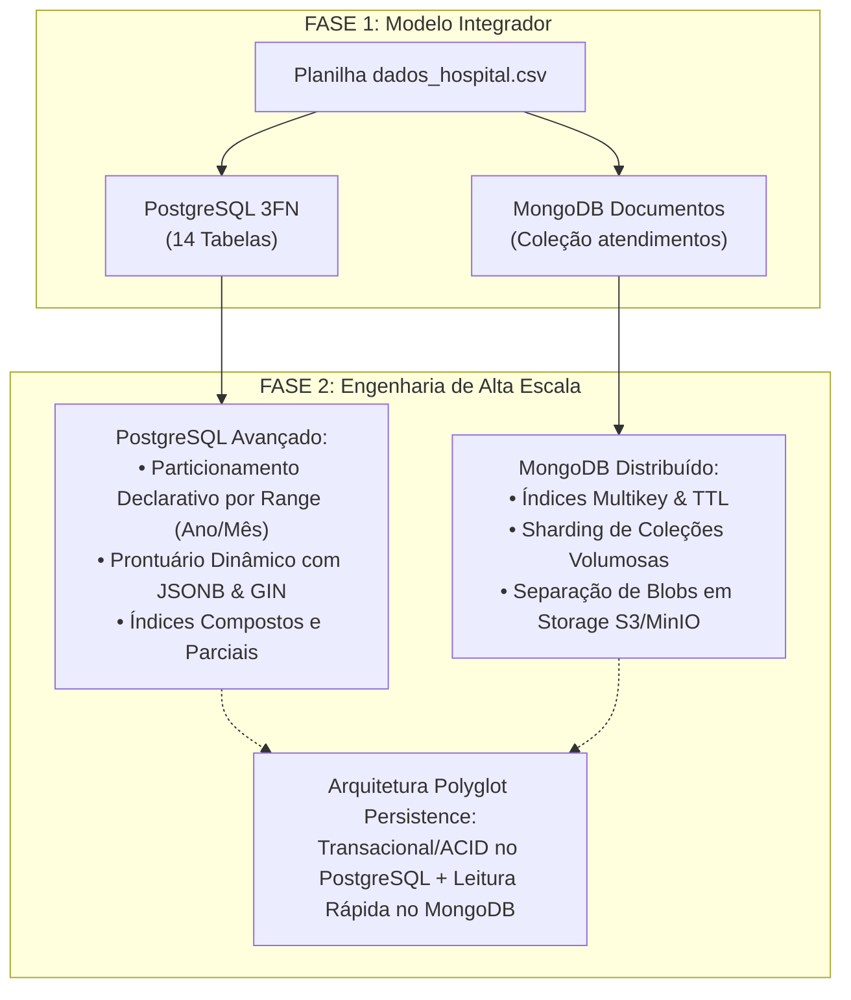
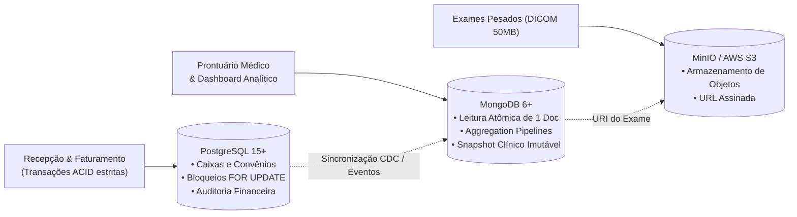

# 🏥 Evolução da Arquitetura Hospitalar (Fase 2: Alta Performance & Escala)
## Aprofundamento Teórico-Prático de Engenharia de Dados

**Disciplina:** Tópicos Avançados de Banco de Dados  
**Laboratório Base (Fase 1):** [`Laboratorio_End_to_End_Hospital.md`](Laboratorio_End_to_End_Hospital.md)  
**Aulas de Apoio:** [`Aula01_Performance_Concorrencia_PostgreSQL.md`](../Aula01_Performance_Concorrencia_PostgreSQL.md) e [`Aula02_NoSQL_MongoDB_Arquitetura_Distribuida.md`](../Aula02_NoSQL_MongoDB_Arquitetura_Distribuida.md)

---

## 🎯 Contexto da Fase 2: O Hospital em Produção

Após a conclusão da Fase 1 pelos estudantes, o **Hospital Geral Santa Helena** atinge escala de produção:
* O volume de consultas cresce para **mais de 1.500.000 de atendimentos por ano**.
* A tabela `Consulta` central se torna gigantesca, tornando varreduras sequenciais e reconstruções de índices B-Tree excessivamente lentas.
* Equipes clínicas demandam o registro de parâmetros dinâmicos heterogêneos (sinais vitais, escalas Manchester/Glasgow) que mudam com frequência.

Nesta Fase 2, são exploradas as soluções arquiteturais de alto padrão para sustentar essa escala.

---

## 🧭 Mapa da Arquitetura Avançada



---

## 🚀 1. Evolução do PostgreSQL: Particionamento Declarativo

Com milhões de linhas, particionar a tabela `Consulta` por data permite que o otimizador ignore partições inteiras de anos anteriores (*Partition Pruning*):

```sql
-- Criação da tabela mestre particionada por intervalo de data
CREATE TABLE consulta_particionada (
    id_consulta          BIGINT GENERATED ALWAYS AS IDENTITY,
    data_hora_inicio     TIMESTAMPTZ NOT NULL,
    id_paciente          INTEGER NOT NULL,
    id_medico            INTEGER NOT NULL,
    id_sala              INTEGER NOT NULL,
    id_especialidade     INTEGER NOT NULL,
    id_paciente_convenio INTEGER,
    status               VARCHAR(50) NOT NULL,
    valor_total_faturado NUMERIC(10,2) NOT NULL DEFAULT 0.00,
    PRIMARY KEY (id_consulta, data_hora_inicio)
) PARTITION BY RANGE (data_hora_inicio);

-- Partições por ano:
CREATE TABLE consulta_2023 PARTITION OF consulta_particionada
    FOR VALUES FROM ('2023-01-01 00:00:00+00') TO ('2024-01-01 00:00:00+00');

CREATE TABLE consulta_2024 PARTITION OF consulta_particionada
    FOR VALUES FROM ('2024-01-01 00:00:00+00') TO ('2025-01-01 00:00:00+00');

CREATE TABLE consulta_2025 PARTITION OF consulta_particionada
    FOR VALUES FROM ('2025-01-01 00:00:00+00') TO ('2026-01-01 00:00:00+00');
```

---

## 🧬 2. Aderindo ao Paradigma Híbrido: PostgreSQL + JSONB

Em vez de criar dezenas de tabelas para formulários clínicos que sofrem alterações frequentes de protocolo, o PostgreSQL permite indexar campos semiestruturados com `JSONB` e índices GIN:

```sql
ALTER TABLE consulta_particionada 
ADD COLUMN prontuario_dinamico JSONB;

-- Inserção de dados dinâmicos heterogêneos:
UPDATE consulta_particionada
SET prontuario_dinamico = '{
    "pressao_arterial": "120/80",
    "saturacao_o2": 98,
    "temperatura_c": 36.6,
    "sintomas_relatados": ["cefaleia", "nauseas leves"],
    "triagem_manchester": "Laranja"
}'
WHERE id_consulta = 1;

-- Índice GIN para busca instantânea dentro do JSONB:
CREATE INDEX idx_consulta_prontuario_gin 
ON consulta_particionada USING GIN (prontuario_dinamico);

-- Busca rápida de pacientes com triagem Laranja:
SELECT id_consulta, data_hora_inicio, prontuario_dinamico->>'pressao_arterial' AS pressao
FROM consulta_particionada
WHERE prontuario_dinamico @> '{"triagem_manchester": "Laranja"}';
```

---

## 🏛️ 3. Arquitetura Final: Persistência Poliglota (Polyglot Persistence)

A lição final de arquitetura de dados moderna é compreender a complementaridade entre os motores:


