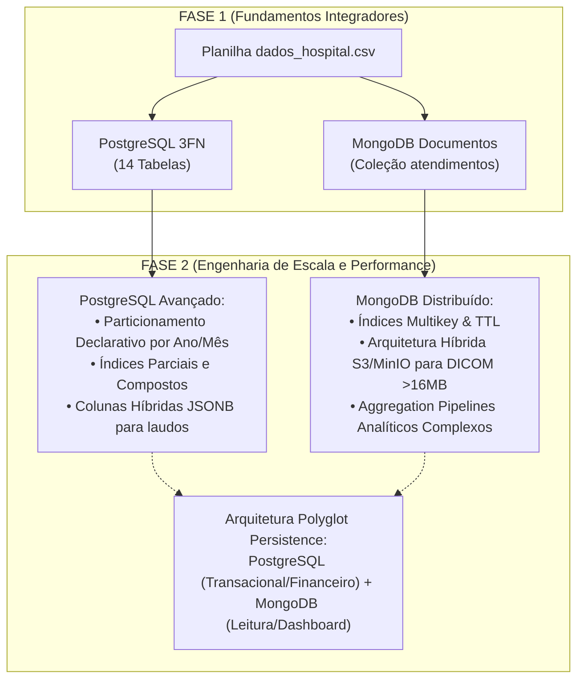
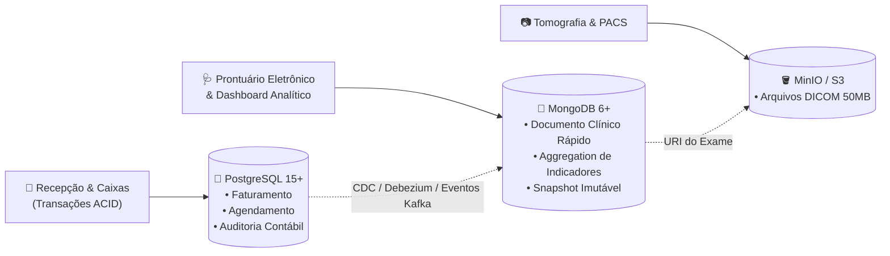

# 🏥 Evolução da Arquitetura Hospitalar (Fase 2: Alta Performance & Escala)
## Continuação Avançada do Laboratório Integrador End-to-End

**Disciplina:** Tópicos Avançados de Banco de Dados  
**Documento Anterior (Fase 1):** [`Laboratorio_End_to_End_Hospital.md`](Laboratorio_End_to_End_Hospital.md)  
**Guia Conceitual:** [`Quebrando_Vicio_SQL.md`](Quebrando_Vicio_SQL.md)  
**Aulas de Apoio:** [`Aula01_Performance_Concorrencia_PostgreSQL.md`](../Aula01_Performance_Concorrencia_PostgreSQL.md) e [`Aula02_NoSQL_MongoDB_Arquitetura_Distribuida.md`](../Aula02_NoSQL_MongoDB_Arquitetura_Distribuida.md)

---

## 🎯 Contexto da Fase 2: O Hospital Cresceu

Na **Fase 1**, você transformou a planilha desestruturada em:
1. Um esquema relacional estrito em **3ª Forma Normal** no **PostgreSQL** (14 tabelas).
2. Uma coleção de documentos transacionais no **MongoDB** aplicando o **Snapshot Pattern**.

Agora, seis meses depois, o **Hospital Geral Santa Helena** expandiu suas operações:
* O volume de consultas saltou de 1.000 para **1.500.000 de atendimentos por ano**.
* As consultas de relatórios gerenciais começaram a competir por CPU e disco com os agendamentos da recepção.
* Médicos exigem a inclusão de campos clínicos dinâmicos (laudos variáveis, exames anexos, escalas de coma de Glasgow).
* O hospital adquiriu um aparelho de Ressonância Magnética de 3 Tesla que gera arquivos DICOM de até **50MB** por exame.

Esta **Fase 2 (Evolução)** apresenta as decisões de engenharia e a resolução técnica dos desafios propostos.

---

## 🧭 Mapa de Evolução da Arquitetura



---

## 🛠️ PARTE 1: Resolução Técnica dos Desafios da Fase 1

### Desafio 1: Diagnóstico e Tuning com `EXPLAIN ANALYZE` (PostgreSQL)

**Problema:** Identificar qual médico realizou o maior número de procedimentos no mês de Outubro/2023, analisando o plano de execução e o algoritmo de junção selecionado pelo otimizador.

#### Consulta SQL Otimizada:

```sql
EXPLAIN (ANALYZE, BUFFERS, VERBOSE)
SELECT 
    m.ID_Medico,
    m.Nome_Medico,
    m.CRM || '/' || m.UF_CRM AS CRM_Completo,
    COUNT(cp.ID_Procedimento) AS Total_Procedimentos,
    SUM(cp.Valor_Cobrado) AS Faturamento_Procedimentos
FROM Medico m
JOIN Consulta c 
    ON c.ID_Medico = m.ID_Medico
JOIN Consulta_Procedimento cp 
    ON cp.ID_Consulta = c.ID_Consulta
WHERE c.Data_Hora_Inicio >= '2023-10-01 00:00:00'
  AND c.Data_Hora_Inicio <  '2023-11-01 00:00:00'
  AND c.Status = 'Realizada'
GROUP BY m.ID_Medico, m.Nome_Medico, m.CRM, m.UF_CRM
ORDER BY Total_Procedimentos DESC
LIMIT 1;
```

#### Análise do Plano de Execução (O que o Engenheiro deve observar):

1. **Seleção de Algoritmos de Junção:**
   * **`Hash Join`** ou **`Nested Loop`**: Para poucos dados de teste, o planejador opta por *Nested Loop* com leitura indexada. Em escala de produção (milhões de linhas), ele constrói uma tabela hash em memória (`Hash Join`) entre `Consulta` e `Consulta_Procedimento`.
2. **Índice Estratégico de Cobertura para Evitar `Seq Scan`:**
   ```sql
   -- Índice composto para acelerar a busca por período e status:
   CREATE INDEX idx_consulta_data_status_medico 
   ON Consulta (Data_Hora_Inicio, Status) 
   INCLUDE (ID_Medico, ID_Consulta);
   ```

---

### Desafio 2: Pipeline Clínico no MongoDB com `$unwind`

**Problema:** Qual é o medicamento mais frequentemente prescrito no hospital para pacientes que possuem alergia declarada a Penicilina?

#### Pipeline de Agregação no MongoDB:

```javascript
db.atendimentos.aggregate([
  // Estágio 1: Filtrar apenas atendimentos de pacientes alérgicos a Penicilina
  {
    $match: {
      "paciente.alergias": "Penicilina"
    }
  },

  // Estágio 2: Desmontar o array de prescrições para avaliar cada remédio individualmente
  {
    $unwind: "$prescricoes"
  },

  // Estágio 3: Agrupar por medicamento e somar ocorrências
  {
    $group: {
      _id: "$prescricoes.medicamento",
      total_prescricoes: { $sum: 1 },
      posologias_frequentes: { $addToSet: "$prescricoes.posologia" }
    }
  },

  // Estágio 4: Formatar a saída
  {
    $project: {
      _id: 0,
      medicamento: "$_id",
      total_prescricoes: 1,
      posologias_utilizadas: "$posologias_frequentes"
    }
  },

  // Estágio 5: Ordenar pelo mais prescrito e pegar o topo
  {
    $sort: { total_prescricoes: -1 }
  },
  {
    $limit: 5
  }
]);
```

---

### Desafio 3: Arquitetura para Exames Pesados (DICOM / Ressonância de 50MB)

**Problema:** O hospital precisa armazenar imagens médicas de 50MB. Onde salvar?

#### Decisão Técnica Fundamentada:

| Abordagem | Viabilidade | Motivo Técnico |
| :--- | :---: | :--- |
| **Embed no documento MongoDB** | ❌ **Inviável** | O limite estrito e intransponível do BSON no MongoDB é de **16MB por documento**. Um exame de 50MB gera erro imediato de inserção (*Document too large*). |
| **MongoDB GridFS** | ⚠️ **Parcial** | O GridFS divide o arquivo em chunks de 255KB em duas collections (`fs.files` e `fs.chunks`). Funciona, mas sobrecarrega o cache do WiredTiger e compete com operações de leitura de dados clínicos. |
| **Object Storage (S3 / MinIO) + Referência NoSQL** | ✅ **Arquitetura Recomendada** | As imagens binárias brutas são armazenadas em bucket de objetos (S3/MinIO/Cloud Storage) com URLs pré-assinadas. O documento do MongoDB armazena apenas os **metadados e a URI do arquivo**. |

#### Documento Resultante no MongoDB:

```json
{
  "_id": ObjectId("6520e1a123f8b1a23c4d5e70"),
  "atendimento_id": 1002,
  "data_hora": "2023-10-15T09:30:00Z",
  "exames_imagem": [
    {
      "tipo": "Ressonancia Magnetica Cranio",
      "modalidade": "DICOM",
      "tamanho_mb": 48.7,
      "storage_provider": "AWS-S3",
      "bucket": "hospital-pacs-laudos",
      "s3_key": "2023/10/paciente_11111111111/rm_cranio_001.dcm",
      "checksum_sha256": "e3b0c44298fc1c149afbf4c8996fb92427ae41e4649b934ca495991b7852b855",
      "laudo_conclusao": "Sem evidência de lesões expansivas intracranianas."
    }
  ]
}
```

---

## 🚀 PARTE 2: Evolução do PostgreSQL — Particionamento e Hibridismo

### 1. Particionamento Declarativo por Range (Tempo)

Com 1,5 milhão de atendimentos ao ano, a tabela `Consulta` central começa a degradar índices B-Tree gigantes. A evolução é particioná-la por ano:

```sql
-- Criação da tabela mestre particionada
CREATE TABLE consulta_particionada (
    id_consulta          BIGINT GENERATED ALWAYS AS IDENTITY,
    data_hora_inicio     TIMESTAMPTZ NOT NULL,
    id_paciente          INTEGER NOT NULL,
    id_medico            INTEGER NOT NULL,
    id_sala              INTEGER NOT NULL,
    id_especialidade     INTEGER NOT NULL,
    id_paciente_convenio INTEGER,
    status               VARCHAR(50) NOT NULL,
    valor_total_faturado NUMERIC(10,2) NOT NULL DEFAULT 0.00,
    PRIMARY KEY (id_consulta, data_hora_inicio)
) PARTITION BY RANGE (data_hora_inicio);

-- Partições anuais:
CREATE TABLE consulta_2023 PARTITION OF consulta_particionada
    FOR VALUES FROM ('2023-01-01 00:00:00+00') TO ('2024-01-01 00:00:00+00');

CREATE TABLE consulta_2024 PARTITION OF consulta_particionada
    FOR VALUES FROM ('2024-01-01 00:00:00+00') TO ('2025-01-01 00:00:00+00');

CREATE TABLE consulta_2025 PARTITION OF consulta_particionada
    FOR VALUES FROM ('2025-01-01 00:00:00+00') TO ('2026-01-01 00:00:00+00');
```

* **Ganho:** Consultas que filtram por `data_hora_inicio >= '2023-10-01'` acionam o **Partition Pruning**, lendo exclusivamente a partição `consulta_2023` e ignorando todo o restante da base em disco!

---

### 2. Aderindo ao Paradigma Híbrido: PostgreSQL + JSONB

Em vez de criar dezenas de tabelas para formulários clínicos que mudam toda semana, o PostgreSQL permite indexar campos JSON semiestruturados com `JSONB` e índices GIN:

```sql
ALTER TABLE consulta_particionada 
ADD COLUMN prontuario_dinamico JSONB;

-- Inserção de dados dinâmicos heterogêneos:
UPDATE consulta_particionada
SET prontuario_dinamico = '{
    "pressao_arterial": "120/80",
    "saturacao_o2": 98,
    "temperatura_c": 36.6,
    "sintomas_relatados": ["cefaleia", "nauseas leves"],
    "triagem_manchester": "Laranja"
}'
WHERE id_consulta = 1;

-- Índice GIN para busca instantânea dentro do JSONB:
CREATE INDEX idx_consulta_prontuario_gin 
ON consulta_particionada USING GIN (prontuario_dinamico);

-- Busca rápida de pacientes com triagem Laranja:
SELECT id_consulta, data_hora_inicio, prontuario_dinamico->>'pressao_arterial' AS pressao
FROM consulta_particionada
WHERE prontuario_dinamico @> '{"triagem_manchester": "Laranja"}';
```

---

## 🏛️ PARTE 3: Arquitetura Final — Polyglot Persistence (Persistência Poliglota)

A conclusão da evolução deste laboratório é entender que **nenhum banco de dados isolado resolve todos os problemas com excelência máxima**.



1. **PostgreSQL:** Gerencia a escrita concorrente de agendamentos (`FOR UPDATE`), o caixa financeiro, restrições relacionais e integridade de chaves.
2. **MongoDB:** Alimenta a tela do médico e o portal do paciente com 1 leitura atômica, além de dashboards analíticos em tempo real via Aggregation.
3. **Object Storage:** Armazena blobs binários pesados sem poluir as tabelas e documentos.
