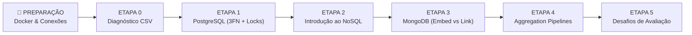
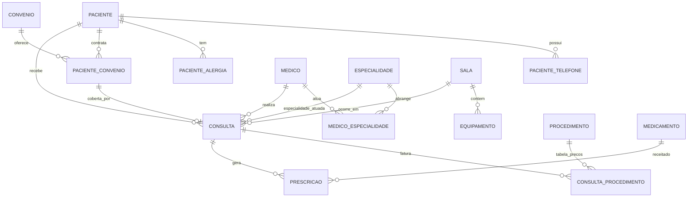
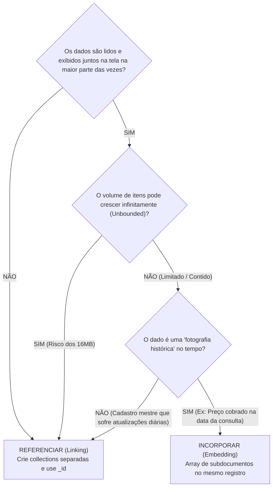
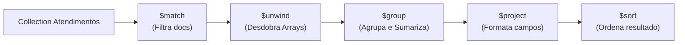

# 🏥 Guia Prático do Aluno: Laboratório Integrador End-to-End
## Da Planilha Caótica à Arquitetura Relacional (PostgreSQL) e NoSQL (MongoDB)

**Disciplina:** Tópicos Avançados de Banco de Dados  
**Papel do Estudante:** Arquiteto(a) de Dados e Engenheiro(a) de Banco de Dados  
**Arquivo de Entrada:** [`dados_hospital.csv`](dados_hospital.csv)  
**Scripts do Laboratório:** [`01_schema_relacional_postgres.sql`](01_schema_relacional_postgres.sql) e [`02_schema_nosql_mongodb.js`](02_schema_nosql_mongodb.js)  
**Tutorial Completo de Infra:** [`Tutorial_Subir_Bases_Containers.md`](../Tutorial_Subir_Bases_Containers.md)

---

> [!IMPORTANT]
> ### 📦 O QUE VOCÊ DEVE ENTREGAR AO PROFESSOR (FORMATO OBRIGATÓRIO)
> 
> Ao concluir as etapas deste laboratório, você deverá enviar **um arquivo compactado `.ZIP`** com o nome no padrão `Nome_Sobrenome_LabHospital.zip`, contendo **exatamente**:
> 
> 1. **`script_solucao_postgres.sql`**: O script SQL que você executou/adaptou no PostgreSQL contendo o DDL, os índices e a consulta do Desafio 1.
> 2. **`script_solucao_mongodb.js`**: O script JavaScript que você executou no MongoDB contendo a criação da coleção e o pipeline de agregação do Desafio 2.
> 3. **`Relatorio_Pratico_Hospital.pdf` (OBRIGATÓRIO EM PDF - 2 a 3 páginas):**
>    * **Página 1:** Identificação do aluno (Nome, Matrícula, Turma) + Diagnóstico das violações de 1FN, 2FN e 3FN encontradas na planilha CSV original.
>    * **Página 2 (Desafio 1 - PostgreSQL):** Print da tela do DBeaver/Terminal executando a query do médico com mais procedimentos com o **`EXPLAIN ANALYZE`** legível + parágrafo explicando se o otimizador usou *Hash Join* ou *Nested Loop*.
>    * **Página 3 (Desafios 2 e 3 - MongoDB):** Print da tela executando o pipeline analítico (`$unwind` + `$group`) para o remédio mais prescrito em alérgicos a Penicilina + **texto de 1 parágrafo** respondendo a decisão técnica de onde salvar os arquivos de imagem médica de 50MB (S3/MinIO vs MongoDB).

---

## 🎯 Sua Missão neste Laboratório

Você foi contratado(a) como Arquiteto(a) de Dados pelo **Hospital Geral Santa Helena**. Hoje, a recepção e o faturamento do hospital operam sobre uma planilha CSV desestruturada, repleta de duplicidades, erros de digitação e travamentos.

O hospital tem duas necessidades tecnológicas simultâneas:
1. **Garantir a integridade financeira e transacional estrita** das consultas e salas cirúrgicas em um banco relacional robusto (**PostgreSQL 15+**), impedindo colisões de agenda e garantindo auditoria.
2. **Prover alta velocidade para a tela de atendimento médico e construir relatórios analíticos de faturamento em tempo real** sem sobrecarregar o banco transacional com dezenas de `JOINs`, utilizando um banco NoSQL orientado a documentos (**MongoDB 6+**).

Neste laboratório prático, você percorrerá todo o ciclo de vida da engenharia de dados: da inicialização dos containers Docker até a tomada de decisões conscientes de arquitetura multi-paradigma.

---

## 🧭 Roteiro das Etapas



---

## 🐳 PREPARAÇÃO: Como Subir os Bancos nos Containers Docker

Antes de iniciar as análises, vamos colocar os motores de banco de dados em execução. Toda a infraestrutura já está pré-configurada na pasta [`advanced-database-lab/`](../../advanced-database-lab/).

### 1. Parâmetros de Conexão dos Containers

| Banco de Dados | Container Docker | Porta do Host | Usuário | Senha | Database / Auth |
| :--- | :--- | :---: | :--- | :--- | :--- |
| **PostgreSQL 15** | `adv_db_postgres` | **`5433`** | `adv_user` | `adv_password` | `adv_recruitment` *(ou hospital_db)* |
| **MongoDB 6** | `adv_db_mongodb` | **`27017`** | `root` | `root_password` | `hospital_db` *(auth: admin)* |

> [!NOTE]
> A porta do PostgreSQL está mapeada para **`5433`** no seu computador para evitar conflito caso você já tenha outro PostgreSQL rodando na porta padrão 5432.

---

### 2. Passo a Passo no Terminal (PowerShell ou Bash)

Abra o seu terminal na pasta do projeto e execute os passos abaixo:

```powershell
# 1. Navegue até a pasta que contém o docker-compose.yml:
cd advanced-database-lab

# 2. Se ainda não tiver o arquivo .env, copie o de exemplo:
Copy-Item .env.example .env

# 3. Suba os containers em segundo plano (background):
docker-compose up -d

# 4. Verifique se ambos os containers estão saudáveis (Up/healthy):
docker ps --filter "name=adv_db"
```

---

### 3. Carga Automatizada dos Dados via Linha de Comando (Fast-Track)

Você pode injetar os dois bancos de uma só vez direto pelo terminal:

```powershell
# Estando dentro da pasta laboratorio-hospital/:

# A) Injeta o PostgreSQL (14 tabelas normalizadas + dados):
Get-Content ".\01_schema_relacional_postgres.sql" | docker exec -i adv_db_postgres psql -U adv_user -d adv_recruitment

# B) Injeta o MongoDB (Coleção atendimentos + JSON Schema + pipelines):
Get-Content ".\02_schema_nosql_mongodb.js" | docker exec -i adv_db_mongodb mongosh -u root -p root_password --authenticationDatabase admin
```

---

### 4. Conexão Visual via DBeaver Community

Se você prefere executar e visualizar as tabelas graficamente:

1. **Conexão PostgreSQL no DBeaver:**
   * **Menu:** *Banco de Dados ➔ Nova Conexão ➔ PostgreSQL*
   * **Host:** `localhost` | **Porta:** `5433`
   * **Banco:** `adv_recruitment`
   * **Usuário:** `adv_user` | **Senha:** `adv_password`
   * Abra o script [`01_schema_relacional_postgres.sql`](01_schema_relacional_postgres.sql) e pressione **`Alt + X`**.

2. **Conexão MongoDB no DBeaver:**
   * **Menu:** *Banco de Dados ➔ Nova Conexão ➔ MongoDB*
   * **Host:** `localhost` | **Porta:** `27017`
   * **Database:** `hospital_db`
   * **Aba Authentication:** Username: `root` | Password: `root_password` | Database: `admin`
   * Abra o script [`02_schema_nosql_mongodb.js`](02_schema_nosql_mongodb.js) e execute.

---

## 📋 ETAPA 0: Diagnóstico e Análise Crítica da Planilha Bruta

Abra o arquivo [`dados_hospital.csv`](dados_hospital.csv) no VSCode ou em seu editor de preferência. Analise uma linha típica gerada pelo sistema legado:

```text
1001;15/10/2023 08:00;111.111.111-11;João Silva;Rua das Flores 123, São Paulo, SP, 01000-000;(11) 9999-1111, (11) 3333-2222;Amendoim, Penicilina;Unimed;12.345.678/0001-90;0800-111-2222;UNI-98765;12345;SP;Dr. Carlos Almeida;Cardiologia;Soc. Bras. Cardiologia;Clínico Geral, Geriatria;101;1º Andar;Máquina de ECG, Desfibrilador;"Eletrocardiograma (1010): R$ 150.00, Aferição (2020): R$ 0.00";"Aspirina 100mg 2x/dia, Losartana 50mg 1x/dia";150.00;Realizada
```

### 🔍 Atividade do Aluno:
Identifique e registre no seu caderno/relatório as violações das Regras de Normalização:

1. **Violações da 1ª Forma Normal (1FN) - Atributos Multivalorados:**
   * Localize colunas que guardam múltiplos valores separados por vírgula em uma única célula (Ex: `Paciente_Telefones`, `Paciente_Alergias`, `Outras_Especialidades_Medico`, `Procedimentos_Realizados_Valores`, `Medicamentos_Prescritos`).
   * *Pergunta para reflexão:* Como você faria um `SELECT` simples para encontrar todos os pacientes alérgicos a Penicilina nessa planilha sem recorrer a um `LIKE '%Penicilina%'` lento e impreciso?
2. **Violações da 2ª e 3ª Formas Normais (2FN e 3FN) - Redundâncias e Anomalias:**
   * Se o paciente João Silva comparecer a 10 consultas, quantas vezes o endereço, os telefones e o CPF dele são replicados?
   * O que acontece se o atendente atualizar o telefone da Unimed (`0800-111-2222`) na linha 1001, mas esquecer de atualizar na linha 1003?

---

## 🐘 ETAPA 1: O Mundo Relacional Normalizado (PostgreSQL)

Para garantir integridade atômica e eliminar as redundâncias da planilha, o hospital projetou uma arquitetura relacional estrita em **3ª Forma Normal**, decomposta em **14 tabelas**.

### 1.1. O Diagrama Entidade-Relacionamento (DER)

Analise atentamente as relações antes de executar o banco:



### 1.2. Execução e Inspeção Prática do Script SQL

1. Abra o script [`01_schema_relacional_postgres.sql`](01_schema_relacional_postgres.sql) no DBeaver ou injete via container.
2. **O que você deve inspecionar no código do script:**
   * **Constraints de Domínio:** Observe como o banco rejeita valores negativos através de `CHECK (Valor_Cobrado >= 0)`.
   * **Integridade Referencial com Ação:** Observe o uso de `ON DELETE CASCADE` para telefones (se o paciente for removido, seus telefones somem) versus `ON DELETE RESTRICT` para médicos e salas (o sistema impede a deleção acidental de um médico que possua histórico de consultas).
   * **Índices Avançados:** Localize o índice composto `idx_consulta_medico_data` e o índice parcial `idx_consulta_cancelada`. Execute um `EXPLAIN ANALYZE` filtrando por consultas canceladas e observe o *Bitmap Index Scan*.

### 1.3. Laboratório de Concorrência: A Batalha pelo Agendamento da Sala (`FOR UPDATE`)

Nenhum hospital pode permitir que dois pacientes sejam agendados para a mesma sala no mesmo minuto. O PostgreSQL resolve isso com controle de concorrência e **bloqueio pessimista**.

> [!IMPORTANT]
> **Instruções para o Teste Prático de Concorrência:**
> Abra **duas abas de script SQL independentes** no DBeaver (cada uma representa uma conexão de um atendente diferente).

* **Na Aba 1 (Atendente Maria):**
  ```sql
  BEGIN;
  -- Maria consulta a Sala 101 e adquire o lock exclusivo:
  SELECT ID_Sala, Numero_Sala, Andar 
  FROM Sala 
  WHERE Numero_Sala = 101 
  FOR UPDATE;

  -- NÃO EXECUTE COMMIT AINDA! Finja que Maria está preenchendo a ficha do paciente...
  ```

* **Na Aba 2 (Atendente João):**
  ```sql
  BEGIN;
  -- João tenta simultaneamente reservar a mesma Sala 101:
  SELECT ID_Sala, Numero_Sala, Andar 
  FROM Sala 
  WHERE Numero_Sala = 101 
  FOR UPDATE;

  -- OBSERVE O QUE ACONTECE:
  -- A query da Aba 2 fica congelada ("Executando..."), aguardando a liberação do recurso!
  ```

* **De volta à Aba 1 (Maria conclui):**
  ```sql
  INSERT INTO Consulta (ID_Paciente, ID_Medico, ID_Especialidade, ID_Sala, Data_Hora_Inicio, Status)
  VALUES (1, 1, 1, 1, '2023-10-25 08:00:00', 'Agendada');
  COMMIT;
  ```

* **Observe o Desfecho na Aba 2:**
  Assim que Maria faz o `COMMIT`, a Aba 2 é imediatamente liberada pelo motor MVCC do Postgres. O sistema de João agora pode verificar que a sala já está ocupada para aquele horário e alertar o atendente. Finalize a transação de João com `ROLLBACK;`.

---

## 🍃 ETAPA 2: A Transição de Mentalidade: O Que é NoSQL e Como Pensar em Documentos?

Até aqui você aprendeu que o modelo relacional é fantástico para consistência e integridade estrita. Mas agora imagine o cenário do pronto-socorro:
* **Problema:** A cada segundo, 50 médicos abrem prontuários clínicos simultaneamente.
* **O Custo no Relacional:** Cada carregamento de tela exige cruzar 8 tabelas com `INNER JOIN` e `LEFT JOIN`. O disco do servidor opera em rotação alta buscando blocos espalhados.

> [!TIP]
> **Leitura Fundamental Prévia:** Antes de continuar, estude o [`Quebrando_Vicio_SQL.md`](Quebrando_Vicio_SQL.md). Ele contém 7 diagramas visuais demonstrando a desconstrução dos dogmas de 1970, a dor da escala horizontal, o descompasso de impedância e por que duplicar dados no NoSQL não é pecado, mas sim um requisito de auditoria (*Snapshot Pattern*).

> [!WARNING]
> **Cuidado com o vício relacional!**
> No NoSQL, **NÃO modelamos pensando na entidade isolada**. Nós modelamos pensando nos **Padrões de Acesso da Aplicação (*Application Access Patterns*)**.
> Em vez de perguntar *"Quantas tabelas eu crio para não ter duplicidade?"*, pergunte:  
> 👉 *"Qual é o documento completo que a tela da minha aplicação precisa carregar de uma só vez?"*

### 2.1. O Dicionário Rápido de Tradução

| Conceito no PostgreSQL | Equivalente no MongoDB | Como funciona no MongoDB |
| :--- | :--- | :--- |
| **Banco de Dados** | **Database** | Agrupador de coleções. |
| **Tabela** | **Coleção (*Collection*)** | Não exige schema rígido definido previamente. |
| **Linha / Registro** | **Documento BSON** | Objeto hierárquico similar a JSON, com tipos nativos (`Date`, `ObjectId`, `Decimal128`). |
| **Coluna** | **Campo (*Field*)** | Pode conter valores atômicos, subdocumentos ou arrays. |
| **Chave Primária (`PK`)** | Campo **`_id`** | Identificador exclusivo gerado nativamente pelo driver/servidor. |
| **`JOIN` entre tabelas** | **`Embedding`** (subdocumentos) ou **`$lookup`** | Priorizamos trazer os dados juntos no mesmo documento. |

---

## ⚖️ ETAPA 3: A Grande Decisão Arquitetural: Incorporar (*Embed*) ou Referenciar (*Link*)?

Ao projetar uma coleção no MongoDB, você enfrentará um dilema para cada relacionamento. Use este fluxograma como guia obrigatório de decisão:



### As Regras de Ouro da Modelagem Hospitalar:

1. **Por que INCORPORAR (*Embed*) Paciente, Médico, Procedimentos e Prescrições dentro do Atendimento?**
   * **Motivo 1: Performance Atômica (1 Doc Scan).** A tela do médico busca o atendimento pelo ID e recebe em **um único milissegundo** tudo o que precisa: o nome do paciente, os telefones, as alergias, o médico responsável, os procedimentos realizados e os remédios prescritos. Não há nenhum `JOIN`.
   * **Motivo 2: O Padrão Fotografia (*Snapshot Pattern*).** Uma consulta médica realizada em 15/10/2023 é um fato jurídico e histórico imutável. Mesmo que o Dr. Carlos Almeida mude de CRM ou especialidade em 2025, ou que o exame de Eletrocardiograma aumente de R$ 150,00 para R$ 300,00, **o documento daquela consulta de 2023 não pode ser alterado retroativamente**.
2. **Por que MANTER coleções de REFERÊNCIA (`pacientes_cadastro`, `medicos_cadastro`) separadas?**
   * Para alimentar formulários de cadastro mestre, buscas administrativas por CPF/CRM e validações prévias de agendamento.
3. **Atenção ao Limite Físico de 16MB por Documento:**
   * Nunca incorpore um relacionamento 1:N que cresça indefinidamente (*unbounded*). Exemplo: **não** guarde todos os atendimentos da vida inteira de um paciente dentro do documento do paciente. Se o paciente for idoso ou tiver histórico de internação crônica, o documento dele acumulará milhares de registros e estourará o limite de 16MB do MongoDB!

---

## 🛠️ ETAPA 4: Implementação e Análise no MongoDB

Abra e execute o script [`02_schema_nosql_mongodb.js`](02_schema_nosql_mongodb.js) via `mongosh` ou DBeaver.

### 4.1. Anatomia do Documento de Atendimento

Observe a estrutura de um documento da coleção `atendimentos`:

```javascript
{
  "_id": ObjectId("6520e1a123f8b1a23c4d5e6f"),
  "atendimento_id": 1001,
  "data_hora": ISODate("2023-10-15T08:00:00Z"),
  "status": "Realizada",
  "paciente": {
    "cpf": "111.111.111-11",
    "nome": "João Silva",
    "telefones": ["(11) 9999-1111", "(11) 3333-2222"],
    "alergias": ["Amendoim", "Penicilina"]
  },
  "medico": {
    "crm": "12345/SP",
    "nome": "Dr. Carlos Almeida",
    "especialidade_atendimento": "Cardiologia"
  },
  "procedimentos": [
    { codigo_tuss: "1010", nome: "Eletrocardiograma", valor: 150.00 },
    { codigo_tuss: "2020", nome: "Aferição de Pressão", valor: 0.00 }
  ],
  "prescricoes": [
    { medicamento: "Aspirina 100mg", posologia: "2x ao dia" }
  ],
  "valor_total_faturado": 150.00
}
```

### 4.2. Consultas em Arrays: A Importância do `$elemMatch`

Tente entender este desafio: *"Como encontrar atendimentos em que um procedimento específico custou mais de R$ 100,00 e tinha o código '1010'?"*

Se você fizer uma busca normal com múltiplos critérios em campos de array, o MongoDB pode cruzar dados de elementos diferentes. O operador **`$elemMatch`** garante que **todos os critérios sejam satisfeitos pelo MESMO objeto dentro do array**:

```javascript
db.atendimentos.find({
  procedimentos: {
    $elemMatch: {
      codigo_tuss: "1010",
      valor: { $gte: 100.00 }
    }
  }
});
```

---

## 🏭 ETAPA 5: O Aggregation Framework (A Linha de Montagem Analítica)

No PostgreSQL, você usa `GROUP BY`, `SUM()` e `HAVING` em uma única sentença SQL declarativa.  
No MongoDB, o processamento analítico funciona como uma **linha de montagem industrial (Pipeline de Estágios)**: cada estágio recebe uma coleção de documentos, processa-a, transforma-a e entrega o resultado pronto para o próximo estágio.



### 5.1. Caso Prático 1: Esteira de Faturamento por Especialidade Médica

Execute e compreenda o fluxo desta esteira analítica:

```javascript
db.atendimentos.aggregate([
  // Estágio 1: Filtrar apenas atendimentos faturáveis finalizados (Equivalente ao WHERE)
  {
    $match: {
      status: "Realizada"
    }
  },

  // Estágio 2: Agrupar por Especialidade e calcular métricas de faturamento (Equivalente ao GROUP BY)
  {
    $group: {
      _id: "$medico.especialidade_atendimento",
      total_consultas: { $sum: 1 },
      faturamento_total: { $sum: "$valor_total_faturado" },
      ticket_medio: { $avg: "$valor_total_faturado" }
    }
  },

  // Estágio 3: Formatar a saída e arredondar valores (Equivalente ao SELECT com alias)
  {
    $project: {
      _id: 0,
      especialidade: "$_id",
      total_consultas: 1,
      faturamento_total: { $round: ["$faturamento_total", 2] },
      ticket_medio: { $round: ["$ticket_medio", 2] }
    }
  },

  // Estágio 4: Ordenar pelas especialidades que mais faturaram (Equivalente ao ORDER BY)
  {
    $sort: { faturamento_total: -1 }
  }
]);
```

### 5.2. Caso Prático 2: Quebrando Arrays com `$unwind`

O `$group` não consegue agrupar diretamente itens que estão presos dentro de um array.  
O operador **`$unwind`** "desmonta" o array: se um atendimento teve 2 procedimentos, o `$unwind` cria 2 documentos temporários idênticos na memória, cada um contendo apenas 1 procedimento atômico.

Execute o pipeline para descobrir quais procedimentos geraram mais receita:

```javascript
db.atendimentos.aggregate([
  // Estágio 1: Desmonta o array de procedimentos em itens individuais
  { $unwind: "$procedimentos" },

  // Estágio 2: Agrupa pelo nome do procedimento
  {
    $group: {
      _id: "$procedimentos.nome",
      quantidade_executada: { $sum: 1 },
      receita_total: { $sum: "$procedimentos.valor" }
    }
  },

  // Estágio 3: Ordena pelos mais executados
  { $sort: { quantidade_executada: -1 } }
]);
```

---

## ⚖️ ETAPA 6: Matriz Comparativa de Decisão Arquitetural

Como arquiteto(a) de dados, você deve saber justificar suas escolhas técnicas:

| Critério de Avaliação | Abordagem Relacional (PostgreSQL) | Abordagem NoSQL em Documentos (MongoDB) |
| :--- | :--- | :--- |
| **Normalização & Redundância** | **Alta (3FN):** Zero redundância. Espaço em disco otimizado. | **Desnormalização Consciente:** Redundância calculada para maximizar velocidade de leitura. |
| **Custo de Leitura da Consulta** | **Médio/Alto:** Requer cruzar 6 a 8 tabelas via `JOIN`. | **Mínimo:** 1 leitura atômica traz o atendimento completo (*1 doc scan*). |
| **Atualização de Cadastro Mestre** | **Mínimo:** Alterar o nome de um médico em 1 registro reflete instantaneamente em tudo. | **Médio:** Exige atualizar coleções mestres e decidir se mantém o nome antigo nos históricos. |
| **Concorrência e Regras de Negócio** | **Motor do Banco:** `FOREIGN KEY`, `CHECK`, `FOR UPDATE`, Níveis de Isolamento estritos. | **Aplicação:** Validação por JSON Schema, regras no backend ou transações multi-documento. |
| **Escalabilidade sob Carga Extrema** | Tipicamente **Vertical** (particionamento e réplicas de leitura). | Nativa **Horizontal** (*Sharding* distribuído por nós geográficos ou chaves de partição). |

---

## 🏁 Desafios Avaliativos para os Alunos (Entregáveis)

Para comprovar o domínio prático dos dois paradigmas, você deve resolver os seguintes desafios e anexar o código SQL/JS e os resultados no seu relatório de entrega:

### Desafio 1 (PostgreSQL): Diagnóstico e Tuning com `EXPLAIN ANALYZE`
* Escreva uma query SQL que identifique **qual médico realizou o maior número de procedimentos no mês de Outubro/2023**.
* Execute a query com `EXPLAIN ANALYZE`.
* Verifique qual nó de junção o otimizador escolheu (`Hash Join`, `Nested Loop` ou `Merge Join`) e justifique o porquê com base no volume de dados.

### Desafio 2 (MongoDB): Pipeline Analítico Clínico com `$unwind`
* Construa um pipeline de agregação no MongoDB que responda:  
  👉 *"Qual é o medicamento mais frequentemente prescrito no hospital para pacientes que possuem alergia a Penicilina?"*
* *Dica de Arquiteto:* Seu pipeline precisará de um `$match` inicial no array de alergias do paciente, seguido de um `$unwind` no array de prescrições, um `$group` pelo nome do medicamento e um `$sort`.

### Desafio 3 (Decisão de Arquitetura - Estudo de Caso Escrito):
* O hospital vai começar a armazenar imagens de **Ressonância Magnética e Laudos de Tomografia** de até 50MB por exame.
* Você incorporaria essas imagens no documento de atendimento no MongoDB ou usaria referência (com armazenamento em bucket S3/MinIO ou GridFS)?  
* **Justifique a sua resposta com base nas limitações físicas de tamanho de documento do MongoDB vistas em aula.**

---

## 📦 Instruções Detalhadas de Entrega

O estudante deverá enviar na plataforma acadêmica (ou por e-mail, conforme orientação do professor) **um arquivo ZIP único** nomeado como:
`[SEU_NOME]_[SEU_SOBRENOME]_Lab_Hospital.zip`

O arquivo compactado deve conter **apenas os 3 itens a seguir**:

```text
📦 Seu_Nome_Sobrenome_Lab_Hospital.zip
 ├── 📄 script_postgres.sql         (Script SQL que você executou no PostgreSQL)
 ├── 📄 script_mongodb.js           (Script JavaScript que você executou no MongoDB)
 └── 📑 Relatorio_Hospital.pdf      (Relatório curto de 2 a 3 páginas - OBRIGATÓRIO EM PDF)
```

---

### 📑 Estrutura Obrigatória do Relatório em PDF (2 a 3 Páginas):

| Página | Seção Obrigatória | Conteúdo Exigido |
| :---: | :--- | :--- |
| **Página 1** | **Identificação & Diagnóstico da Planilha** | • Nome Completo, Matrícula e Turma.<br/>• Breve tabela ou tópicos listando as 3 principais violações de normalização (1FN, 2FN, 3FN) identificadas na planilha [`dados_hospital.csv`](dados_hospital.csv). |
| **Página 2** | **Desafio 1: Diagnóstico com EXPLAIN ANALYZE (PostgreSQL)** | • **Print nítido da tela do DBeaver/Terminal** executando a query com o `EXPLAIN ANALYZE`.<br/>• **Texto explicativo (1 parágrafo):** Qual médico realizou mais procedimentos e qual nó de junção (`Hash Join` ou `Nested Loop`) o banco utilizou, justificando o porquê. |
| **Página 3** | **Desafios 2 e 3: MongoDB & Decisão de Arquitetura** | • **Print da tela** executando o pipeline de agregação no MongoDB com o resultado legível (remédio mais prescrito em alérgicos a Penicilina).<br/>• **Parecer Técnico (1 parágrafo):** Resposta fundamentada ao Desafio 3 sobre onde armazenar arquivos de imagens médicas de 50MB (explicando o teto de 16MB do BSON no MongoDB vs armazenamento de objetos em S3/MinIO). |

> [!CAUTION]
> **Atenção aos Critérios de Correção do Professor:**
> * Relatórios entregues em Word (`.docx`), imagens soltas ou fora do formato **PDF** sofrerão desconto de nota.
> * Os prints devem estar legíveis, mostrando a consulta executada e o resultado retornado pelo SGBD.
> * Utilize o modelo pronto disponível em: [`TEMPLATE_RELATORIO_ALUNO.md`](TEMPLATE_RELATORIO_ALUNO.md) para redigir seu trabalho e exportar diretamente para PDF.

---

## 🚀 Próximo Passo: A Evolução da Arquitetura (Fase 2)

Para conferir a evolução de engenharia em cenários de alta escala com **particionamento declarativo por ano/mês**, **campos híbridos JSONB** e **arquitetura distribuída (Polyglot Persistence)**, consulte o documento complementar deste estudo de caso:

👉 **[Evolucao_Laboratorio_Hospital_Fase2.md](Evolucao_Laboratorio_Hospital_Fase2.md)**
