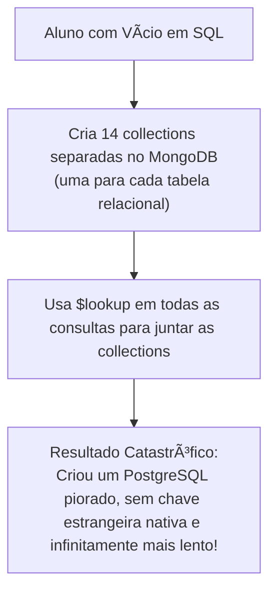
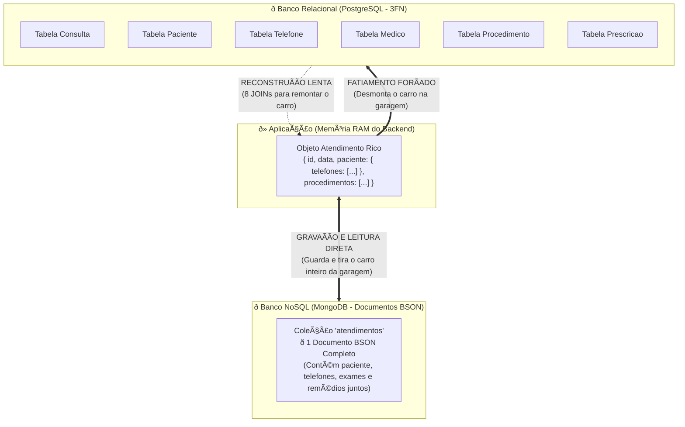
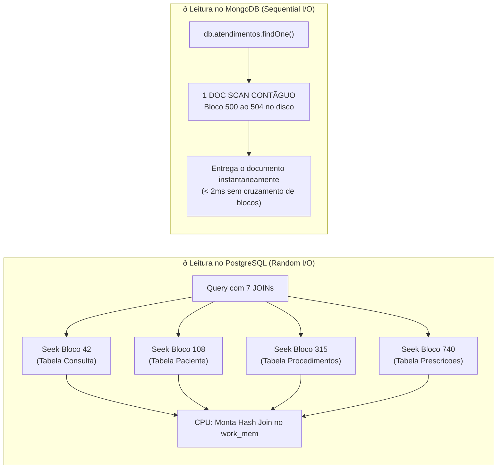
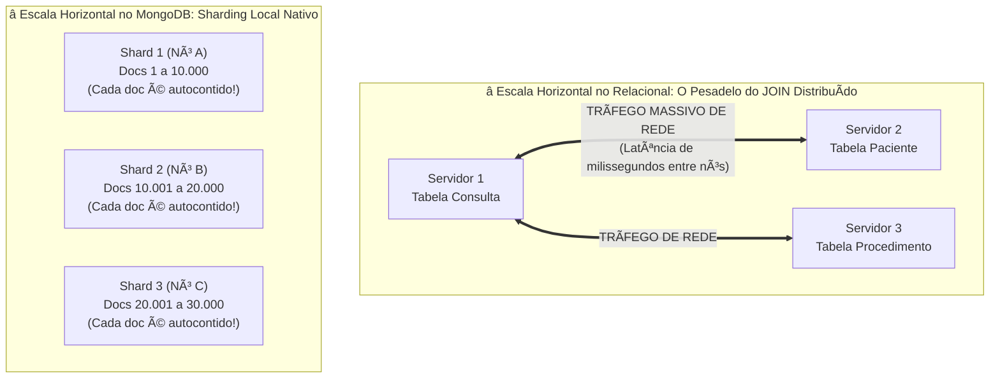
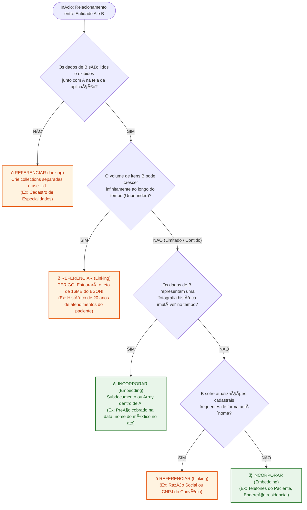
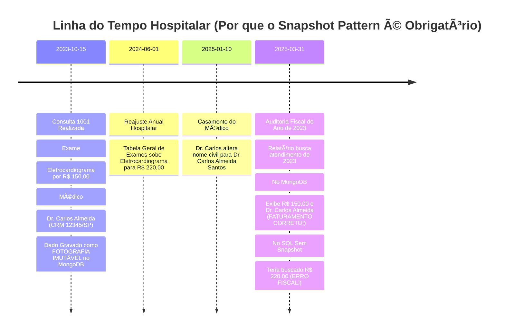
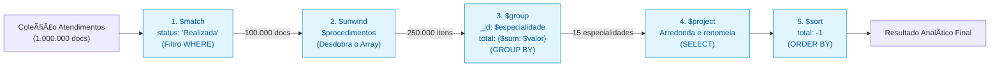

# ⚡ Choque de Realidade: Como Quebrar o Vício do SQL e Pensar em NoSQL
## Guia Visual de Transição de Paradigma: Da Normalização Estrita à Modelagem em Documentos

**Disciplina:** Tópicos Avançados de Banco de Dados  
**Público-Alvo:** Estudantes e Desenvolvedores formados no modelo relacional (PostgreSQL / MySQL / Oracle)  
**Objetivo:** Desconstruir dogmas do SQL que impedem o raciocínio distribuído e aprender a pensar visualmente em documentos BSON.

---

## 🛑 O Diagnóstico: Você tem "Vício em SQL"?

Se você aprendeu banco de dados nos últimos anos, provavelmente ouviu os seguintes mandamentos como verdades sagradas e imutáveis:

1. *"Duplicar dados é o pior pecado que um desenvolvedor pode cometer."*
2. *"Tudo no mundo deve ser decomposto até a 3ª Forma Normal (3FN)."*
3. *"Se duas entidades se relacionam, crie uma chave estrangeira e junte com `JOIN`."*
4. *"O banco de dados deve ser o único responsável por garantir a integridade de tudo."*

Essas regras funcionaram com louvor durante 40 anos. Porém, quando você tenta aplicar **esses mesmos dogmas** diretamente no MongoDB, acontece uma tragédia arquitetural:

---

## 📊 DIAGRAMA 1: Anatomia Estrutural — Desmontagem Relacional vs Objeto Vivo

A principal razão da dor do desenvolvedor moderno é o **Descompasso de Impedância (*Impedance Mismatch*)**:

> **A Metáfora da Garagem:**  
> Salvar dados em tabelas relacionais é como desmontar seu carro peça por peça toda vez que você o guarda na garagem e ter que remontar tudo na manhã seguinte antes de ir trabalhar. No MongoDB, você guarda e retira o carro inteiro!

---

## 💽 DIAGRAMA 2: A Física do Disco — Random I/O vs Leitura Contígua

Por que uma consulta médica no MongoDB responde em 1 milissegundo enquanto no PostgreSQL sob alta concorrência ela pode demorar 80 milissegundos? **A resposta está na física do disco (I/O).**

---

## 🌐 DIAGRAMA 3: O Paradoxo da Escala Horizontal (Por que o JOIN Quebra na Nuvem?)

No modelo relacional tradicional, para suportar mais carga, usamos **Escala Vertical** (servidores maiores e mais caros). Na nuvem moderna, usamos **Escala Horizontal** (distribuir os dados em múltiplos nós com *Sharding*).

Observe o que acontece quando tentamos rodar um `JOIN` em um cluster distribuído:

> **A Conclusão Arquitetural:**  
> Como no MongoDB o documento de atendimento já contém o paciente e os procedimentos dentro de si, **nenhum servidor precisa conversar com outro pela rede para responder a consulta!** A query é resolvida 100% localmente no shard responsável.

---

## 🔄 DIAGRAMA 4: A Inversão do Fluxo Mental de Modelagem

Como um Arquiteto Relacional pensa vs Como um Arquiteto NoSQL pensa:

```mermaid
flowchart TD
    subgraph MENTAL_SQL["🐘 Fluxo Mental Relacional (Orientado à Entidade)"]
        A1["1. Analisa as Entidades do Mundo Real"] --> A2["2. Aplica Normalização Estrita (1FN, 2FN, 3FN)"]
        A2 --> A3["3. Cria Tabelas Rígidas e Chaves Estrangeiras"]
        A3 --> A4["4. O Desenvolvedor sofre escrevendo queries complexas com JOIN para atender as telas"]
    end

    subgraph MENTAL_NOSQL["🍃 Fluxo Mental NoSQL (Orientado ao Padrão de Acesso)"]
        B1["1. Analisa as Telas da Aplicação e APIs (UI/UX)"] --> B2["2. Mapeia os Padrões de Acesso (Quais dados são lidos/gravados juntos?)"]
        B2 --> B3["3. Desenha Documentos Ricos que atendem a tela em 1 leitura"]
        B3 --> B4["4. Decide pontualmente o que incorporar e o que referenciar"]
    end
```

---

## 🌳 DIAGRAMA 5: Árvore de Decisão Visual — Embedding vs Linking

Este é o mapa que os alunos devem ter na mesa ao modelar qualquer coleção no MongoDB:

---

## 📷 DIAGRAMA 6: O Padrão Fotografia (*Snapshot Pattern*) no Tempo

Por que duplicar o preço do exame e o nome do médico dentro da consulta **NÃO é redundância errada, mas sim auditoria legal**?

---

## 🏭 DIAGRAMA 7: A Linha de Montagem Analítica (Aggregation Framework)

Como explicar o *Aggregation Framework* para alunos acostumados com o `GROUP BY` declarativo do SQL:

---

## 📋 Resumo Visual das Diferenças

| Característica | PostgreSQL (Relacional) | MongoDB (NoSQL em Documentos) |
| :--- | :--- | :--- |
| **Metáfora** | Gaveteiro de Peças Desmontadas | Caixa do Produto Montado e Pronto para Uso |
| **Ponto Forte** | Integridade transacional e rigor matemático | Velocidade brutal de leitura e escala horizontal |
| **Ponto Fraco** | JOINs custosos sob alto volume | Exige disciplina de modelagem para não estourar 16MB |
| **Custo de Mudança de Schema** | `ALTER TABLE` pode bloquear tabelas de milhões de linhas | Documentos coexistem com versões diferentes (*Schema Evolution*) |
| **Operações Analíticas** | SQL clássico (`GROUP BY`, `WINDOW FUNCTIONS`) | *Aggregation Pipeline* em esteira sequencial |
