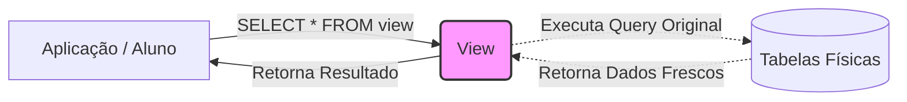
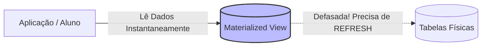
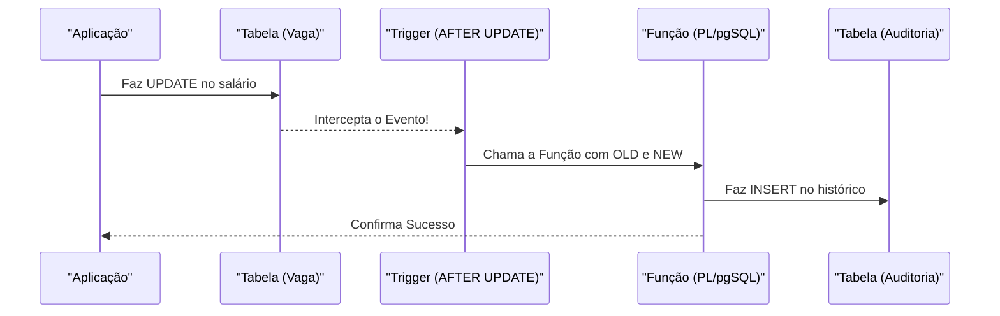

# Laboratório 04: Programação de Banco de Dados

## Objetivo
Explorar os recursos de programação nativos do banco de dados relacional. Aprender a encapsular lógica complexa e regras de negócio diretamente no SGBD utilizando Views, Functions, Procedures (PL/pgSQL) e Triggers.

## Conceitos
- **Views (Visões):** Tabelas virtuais baseadas no resultado de uma instrução SQL. Facilitam consultas complexas e restringem acesso a colunas específicas.
- **Materialized Views:** Visões que armazenam os dados fisicamente em disco. Ideais para relatórios pesados que não precisam de dados em tempo real.
- **Functions:** Blocos de código que retornam um valor ou tabela. Podem ser chamados dentro de um `SELECT`.
- **Procedures:** Rotinas que executam tarefas, mas não retornam valores (podem usar parâmetros `IN/OUT`). Permitem controle transacional (`COMMIT`/`ROLLBACK`) interno.
- **Triggers:** Gatilhos associados a uma tabela ou view que invocam automaticamente uma função quando ocorre um evento (`INSERT`, `UPDATE`, `DELETE`, `TRUNCATE`).

---

## 📚 Referência: Sintaxe e Exemplos (Tudo em um só lugar)

Antes de iniciar os desafios, consulte este guia prático com exemplos de cada estrutura em PostgreSQL:

### 1. View (Visão Simples)
**O que é?** Uma View funciona como uma "janela virtual" para os seus dados. Ela não armazena dados fisicamente; em vez disso, ela salva a *consulta SQL* (a query) no banco de dados. Toda vez que você faz um `SELECT` na View, o banco de dados executa a query original em tempo real.
**Para que serve?** 
- **Simplificação:** Esconder a complexidade de múltiplos `JOIN`s, `GROUP BY` e cálculos matemáticos extensos de quem vai consumir os dados.
- **Segurança:** Criar uma View que expõe apenas algumas colunas de uma tabela (ex: omitir senhas ou salários) e dar permissão de leitura apenas na View, protegendo a tabela original.



```sql
CREATE OR REPLACE VIEW vw_vagas_abertas AS
SELECT id, titulo, empresa_id 
FROM vaga 
WHERE status = 'ABERTA';

-- Chamada:
-- SELECT * FROM vw_vagas_abertas;
```

### 2. Materialized View (Visão Materializada)
**O que é?** Diferente da View simples, a Materialized View **salva fisicamente** no HD o resultado da consulta no momento em que ela é criada ou atualizada. É como se o banco tirasse uma "foto" ou um "cache" dos dados.
**Para que serve?** 
- **Performance:** Relatórios analíticos gigantescos (ex: faturamento mensal de 10 anos) podem demorar minutos para rodar. Com a Materialized View, a leitura é imediata (milissegundos), pois os dados já foram calculados e gravados.
- **O grande detalhe:** Se os dados da tabela original mudarem, a Materialized View **ficará desatualizada (velha)**. Você precisa rodar o comando `REFRESH MATERIALIZED VIEW` (geralmente programado para rodar de madrugada) para que ela recalcule e tire uma nova "foto".



```sql
CREATE MATERIALIZED VIEW mvw_relatorio_mensal AS
SELECT date_trunc('month', data_aplicacao) as mes, count(*) as total
FROM candidatura
GROUP BY mes;

-- Chamada:
-- SELECT * FROM mvw_relatorio_mensal;
-- Para atualizar os dados:
-- REFRESH MATERIALIZED VIEW mvw_relatorio_mensal;
```

### 3. Function (Função - Retorna Valores)
**O que é?** É um bloco de código de programação (em PL/pgSQL, por exemplo) salvo no banco de dados que recebe parâmetros (opcional), executa uma lógica (cálculos, validações) e **obrigatoriamente retorna algo** (um número, um texto ou até uma tabela inteira).
**Para que serve?**
- **Centralizar Regras de Negócio:** Se o cálculo de uma rescisão trabalhista for complexo, em vez de codificar isso em Java, Node e Python, você cria a função no banco. Todas as aplicações simplesmente chamam a função.
- Pode ser chamada "dentro" de uma consulta `SELECT`, aplicando transformações linha a linha.
```sql
CREATE OR REPLACE FUNCTION fn_calcula_bonus(salario DECIMAL)
RETURNS DECIMAL 
LANGUAGE plpgsql
AS $$
BEGIN
    RETURN salario * 0.10; -- 10% de bônus
END;
$$;

-- Chamada:
-- SELECT titulo, salario, fn_calcula_bonus(salario) as bonus FROM vaga;
```

### 4. Procedure (Procedimento - Controle Transacional)
**O que é?** Semelhante à Function, mas com um propósito diferente: Procedures são feitas para **executar ações** (rotinas em lote, alterações em massa) e **não retornam valores** (não podem ser chamadas no meio de um `SELECT`). 
**Para que serve?**
- **Transações:** A grande vantagem (introduzida no Postgres 11) é que Procedures permitem que você controle transações internamente. Você pode fazer um `COMMIT` no meio do código para salvar parte do progresso, e um `ROLLBACK` se algo der errado. Functions não conseguem fazer isso (elas são "tudo ou nada").
- São executadas usando o comando `CALL`.
```sql
CREATE OR REPLACE PROCEDURE pr_encerrar_vaga(p_vaga_id INT)
LANGUAGE plpgsql
AS $$
BEGIN
    -- Encerra a vaga
    UPDATE vaga SET status = 'ENCERRADA' WHERE id = p_vaga_id;
    
    -- Rejeita todas as candidaturas que ainda estavam pendentes nessa vaga
    UPDATE candidatura SET status = 'REJEITADA' WHERE vaga_id = p_vaga_id AND status != 'CONTRATADO';
    
    COMMIT; -- Confirma a transação
END;
$$;

-- Chamada:
-- CALL pr_encerrar_vaga(1);
```

### 5. Trigger (Gatilho de Eventos)
**O que é?** É uma armadilha, um "gatilho" configurado para disparar automaticamente sempre que um evento específico acontecer numa tabela. Os eventos podem ser `INSERT`, `UPDATE`, `DELETE` ou `TRUNCATE`.
**Para que serve?**
- **Auditoria Infalível:** Registrar quem, quando e o que mudou num registro (ex: guardar o histórico de aumento de salários).
- **Consistência Automática:** Se a tabela Venda receber um `INSERT`, uma Trigger pode automaticamente fazer um `UPDATE` na tabela Estoque para diminuir a quantidade do produto.
- **Validações Rígidas:** Bloquear exclusões ou inserções que burlem regras de negócio (usando `RAISE EXCEPTION`), impedindo que até mesmo o DBA faça besteira.



No PostgreSQL, a criação de uma Trigger é dividida em **duas etapas**:
1. Criar a **Função** que contém a lógica que será executada. Essa função tem acesso a variáveis mágicas chamadas `NEW` (novo registro) e `OLD` (registro antigo).
2. Criar a **Trigger** propriamente dita, que amarra essa Função ao evento da Tabela.
```sql
-- ETAPA 1: A função que a trigger vai executar (tem acesso ao NEW e OLD)
CREATE OR REPLACE FUNCTION fn_log_candidato()
RETURNS TRIGGER 
LANGUAGE plpgsql
AS $$
BEGIN
    IF NEW.nome IS NULL THEN
        RAISE EXCEPTION 'Nome não pode ser nulo!';
    END IF;
    RETURN NEW; 
END;
$$;

-- ETAPA 2: A Trigger vinculando a função à tabela
CREATE TRIGGER trg_valida_candidato
BEFORE INSERT OR UPDATE ON candidato
FOR EACH ROW
EXECUTE FUNCTION fn_log_candidato();
```

---

## Problema
O sistema da Plataforma de Recrutamento cresceu. Consultas recorrentes estão se tornando difíceis de gerenciar na aplicação, regras de negócio estão sendo burladas por inserções manuais, e precisamos de um sistema de auditoria confiável para alterações sensíveis (como salários de vagas).

---

## Procedimento 

A equipe de BI precisa consultar frequentemente os dados das vagas junto com o nome da empresa e a quantidade de candidatos aplicados, mas eles não querem escrever `JOIN` e `GROUP BY` toda vez.

**Desafio:**
Crie uma view chamada `vw_vagas_completas` que retorne:
- `vaga_id` (ID da vaga)
- `titulo` (Título da vaga)
- `nome_empresa` (Nome da empresa dona da vaga)
- `salario`
- `total_candidatos` (Contagem de candidaturas vinculadas a essa vaga)

*Dica:* Use `LEFT JOIN` para incluir vagas que ainda não possuem candidatos (total 0).

---

## Investigação 

O RH quer uma forma simplificada de registrar que um candidato foi contratado para uma vaga. O processo exige duas ações:
1. Mudar o status da `candidatura` para 'CONTRATADO'.
2. Mudar o status da `vaga` para 'PREENCHIDA'.

**Desafio:**
Crie uma procedure chamada `pr_contratar_candidato(p_candidato_id INT, p_vaga_id INT)`.
Dentro dela, faça os `UPDATE`s necessários nas tabelas `candidatura` e `vaga`. Lembre-se de utilizar a vantagem transacional (COMMIT).

---

## Desafio 

A diretoria ficou preocupada com alterações não rastreadas nos salários oferecidos pelas vagas. Eles pediram uma tabela de histórico para auditar sempre que o salário de uma vaga for **alterado**.

**Desafio:**
1. Crie uma tabela `auditoria_salario_vaga`:
   - `id` (SERIAL PRIMARY KEY)
   - `vaga_id` (INT)
   - `salario_antigo` (DECIMAL)
   - `salario_novo` (DECIMAL)
   - `data_alteracao` (TIMESTAMP default NOW())
2. Crie uma **Function** que será executada pela Trigger. Ela deve verificar se o `NEW.salario` é diferente do `OLD.salario`. Se for, insira um registro na tabela de auditoria.
3. Crie uma **Trigger** chamada `trg_audita_salario` na tabela `vaga`, que dispare `AFTER UPDATE` e execute a função criada.

Escreva a solução para todos os três níveis em um arquivo chamado `solucao.sql` e teste no seu banco de dados.

---
## Perguntas
- Qual é a principal diferença de desempenho e casos de uso entre uma `VIEW` e uma `MATERIALIZED VIEW`?
- Por que a regra de negócio de "auditoria de salário" (Nível 3) é geralmente implementada via Trigger no banco de dados em vez de ser feita na aplicação?
