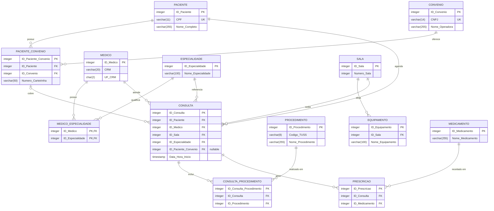

# Solução: Modelagem Hospitalar Nível Avançado (3FN)

Esta solução atende às regras de negócio complexas do Sistema de Gestão Hospitalar Complexo (SGHC), respeitando as Formas Normais.

---

## 1. Justificativas de Normalização para os Novos Requisitos

### Convênios e Pacientes (Relacionamento N:M)
*   **Problema:** Um paciente pode ter vários planos. Colocar essas informações na tabela de `Paciente` violaria a 1FN (atributos multivalorados) e 2FN/3FN (carteirinha depende do plano, não do paciente).
*   **Solução:** Criar a tabela `Convenio` (CNPJ, Nome) e uma tabela associativa `Paciente_Convenio` para guardar o número da carteirinha, a validade e conectar o Paciente ao Convênio.

### Especialidades Médicas (Relacionamento N:M)
*   **Problema:** O médico agora tem múltiplas especialidades. 
*   **Solução:** Criar a tabela `Medico_Especialidade` (associativa). Além disso, na tabela de `Consulta`, não basta mais ligar apenas ao Médico; precisamos saber *por qual especialidade* ele está atuando naquela consulta. A FK na Consulta deve referenciar o Médico e também a Especialidade.

### Procedimentos da Consulta (Relacionamento N:M)
*   **Problema:** Uma consulta pode envolver vários procedimentos (Eletrocardiograma, Endoscopia, etc).
*   **Solução:** Tabela domínio `Procedimento` (Código TUSS, Nome, Valor) e tabela associativa `Consulta_Procedimento` (registra quais procedimentos ocorreram em qual consulta).

### Equipamentos e Salas
*   **Solução:** A sala pode ter vários equipamentos, mas um equipamento (físico, com número de série) fica em uma sala. Tabela `Equipamento` com FK para a `Sala`.

---

## 2. Estrutura de Tabelas, PKs e FKs

### Domínios e Entidades Independentes

*   **Tabela `Especialidade`**
    *   **PK:** `ID_Especialidade`
    *   *Colunas:* `Nome_Especialidade`, `Conselho`.
*   **Tabela `Convenio`**
    *   **PK:** `ID_Convenio`
    *   *Colunas:* `CNPJ` (Unique), `Nome_Operadora`, `Tipo_Plano`.
*   **Tabela `Procedimento`**
    *   **PK:** `ID_Procedimento`
    *   *Colunas:* `Codigo_TUSS` (Unique), `Nome_Procedimento`, `Valor_Base`.
*   **Tabela `Sala`**
    *   **PK:** `ID_Sala`
    *   *Colunas:* `Numero_Sala` (Unique).
*   **Tabela `Medicamento`**
    *   **PK:** `ID_Medicamento`
    *   *Colunas:* `Nome_Medicamento`.

### Entidades Pessoais (Paciente e Médico)

*   **Tabela `Paciente`**
    *   **PK:** `ID_Paciente`
    *   *Colunas:* `CPF` (Unique), `Nome_Completo`, `Data_Nascimento`.
*   **Tabela `Paciente_Telefone`**
    *   **PK:** `ID_Telefone`
    *   **FK:** `ID_Paciente` (Referencia `Paciente`)
    *   *Colunas:* `Numero`.
*   **Tabela `Paciente_Alergia`**
    *   **PK:** `ID_Alergia`
    *   **FK:** `ID_Paciente` (Referencia `Paciente`)
    *   *Colunas:* `Descricao`.

*   **Tabela `Medico`**
    *   **PK:** `ID_Medico`
    *   *Colunas:* `CRM`, `UF_CRM`, `Nome_Medico`.

### Relacionamentos e Entidades de Vínculo

*   **Tabela `Paciente_Convenio` (A "Carteirinha")**
    *   **PK:** `ID_Paciente_Convenio`
    *   **FKs:** `ID_Paciente` (Ref: `Paciente`), `ID_Convenio` (Ref: `Convenio`)
    *   *Colunas:* `Numero_Carteirinha`, `Data_Validade`.

*   **Tabela `Medico_Especialidade`**
    *   **PK Composta / FKs:** `ID_Medico`, `ID_Especialidade`
    *(Uma chave primária composta garante que o mesmo médico não seja cadastrado duas vezes com a mesma especialidade).*

*   **Tabela `Equipamento`**
    *   **PK:** `ID_Equipamento`
    *   **FK:** `ID_Sala` (Referencia `Sala` - indica onde o equipamento está)
    *   *Colunas:* `Numero_Serie` (Unique), `Nome_Equipamento`, `Data_Manutencao`.

### O Evento Central: A Consulta

*   **Tabela `Consulta`**
    *   **PK:** `ID_Consulta`
    *   **FKs:**
        *   `ID_Paciente`
        *   `ID_Medico`
        *   `ID_Especialidade` (Indica em qual especialidade o médico está atendendo).
        *   `ID_Sala`
        *   `ID_Paciente_Convenio` (Opcional/Nullable. Se nulo, a consulta é Particular. Se preenchido, sabemos exatamente qual carteirinha e plano o paciente usou).
    *   *Colunas:* `Data_Hora_Inicio`, `Duracao_Minutos`, `Status`.

### Pós-Consulta (Receitas e Atos Médicos)

*   **Tabela `Consulta_Procedimento`**
    *   **PK:** `ID_Consulta_Procedimento`
    *   **FKs:** `ID_Consulta`, `ID_Procedimento`
    *   *Colunas:* (Poderia ter `Quantidade` ou `Observacoes`).

*   **Tabela `Prescricao`**
    *   **PK:** `ID_Prescricao`
    *   **FKs:** `ID_Consulta`, `ID_Medicamento`
    *   *Colunas:* `Dosagem`, `Instrucoes_Uso`.

---

## 3. Resumo da Solução
Ao aplicar as formas normais rigorosamente, isolamos as complexidades do mundo real:
1. Um médico pode atender como Pediatra de manhã e Cirurgião à tarde, e o sistema saberá exatamente (via FKs na `Consulta`) qual papel ele estava desempenhando.
2. A recepção não precisará mais digitar o nome do convênio, e faturará as consultas com precisão rastreando o `ID_Paciente_Convenio` utilizado no momento da consulta.
3. Não há redundância de dados de sala, especialidade, procedimentos e medicamentos, erradicando anomalias de atualização.

---

## 4. Diagrama Entidade-Relacionamento (ER)

Abaixo está a representação visual (Modelo Lógico) das tabelas e seus relacionamentos:

